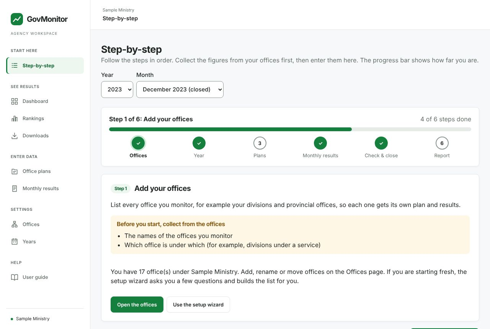
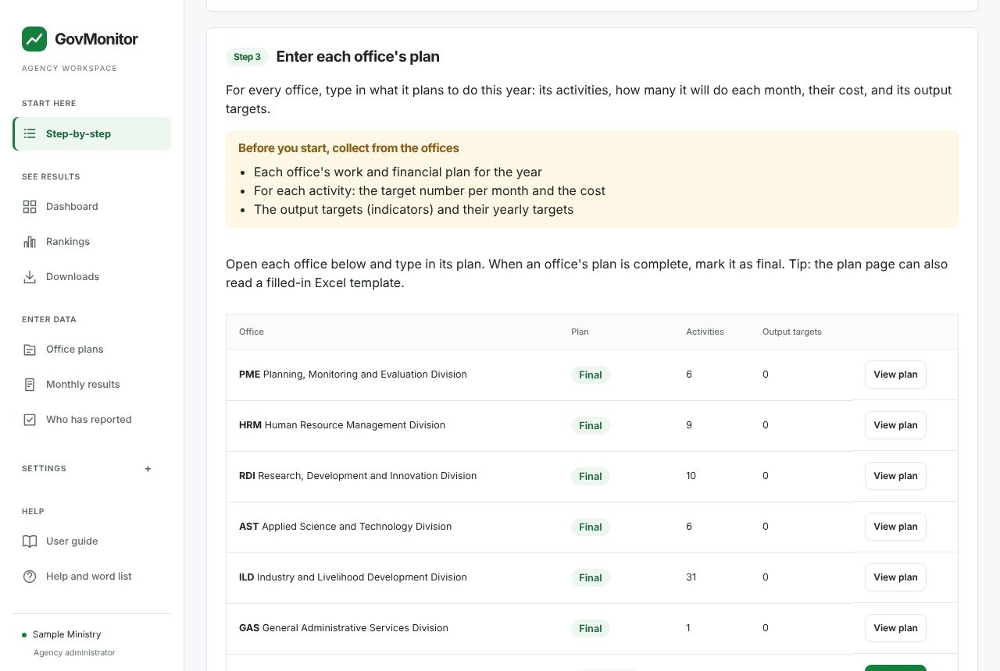
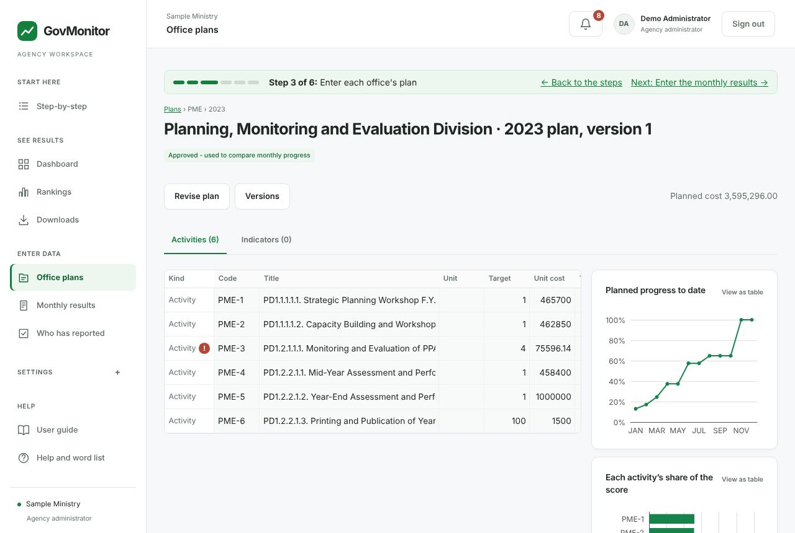
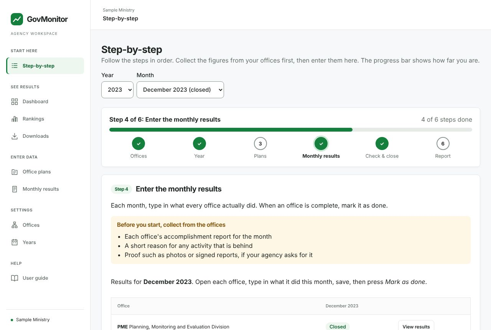
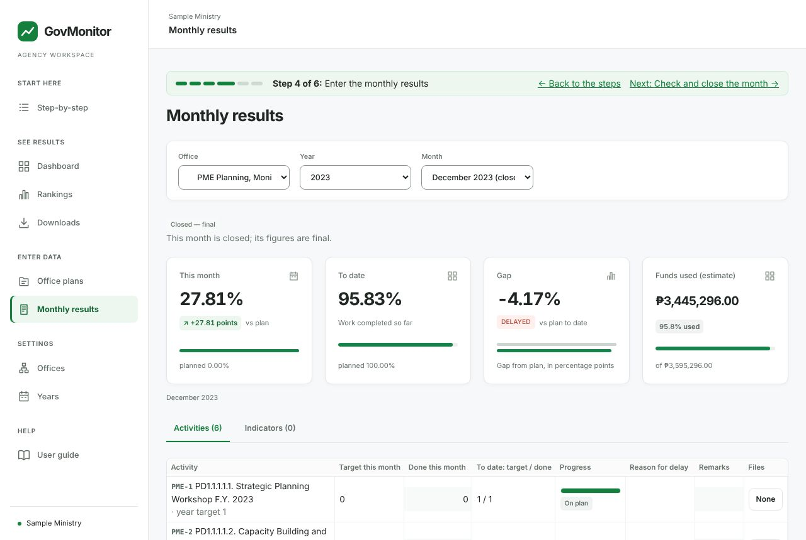
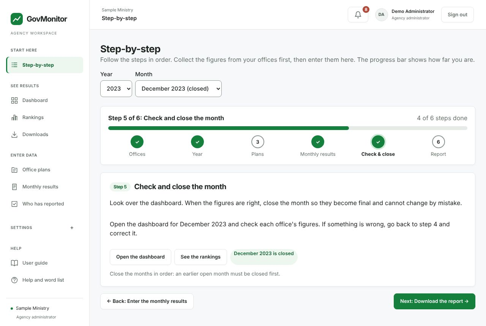
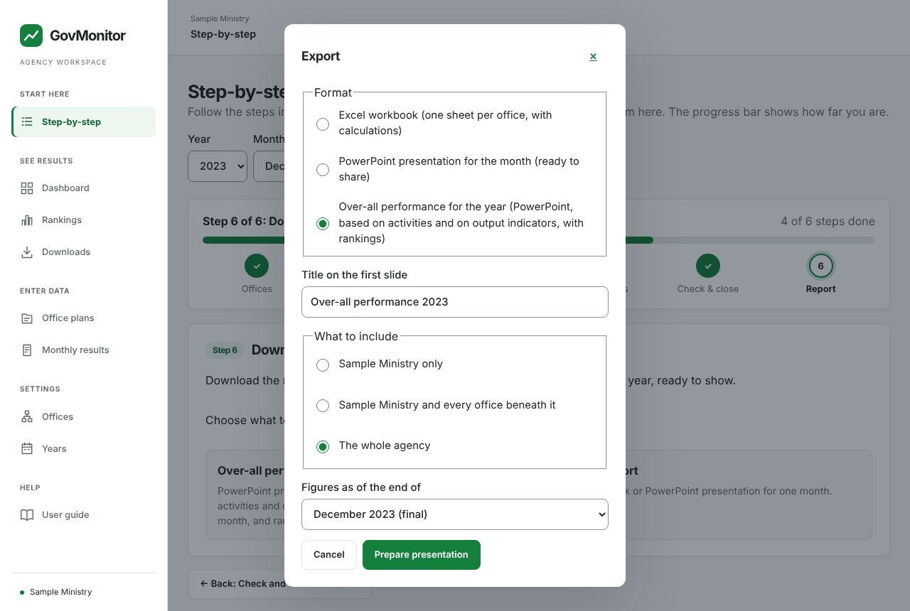
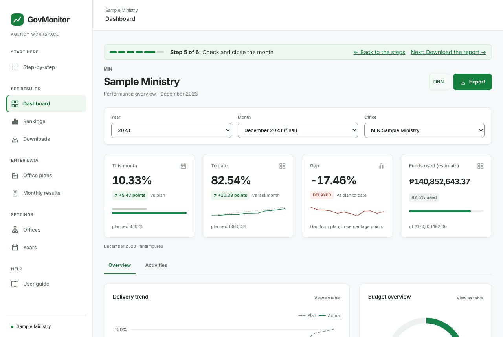

# GovMonitor
## User Guide

Edition 3.0 | 21 November 2026

A simple, step-by-step guide for the person who monitors the offices. No experience needed.

## Contents

1. [Start Here](#start-here)
2. [Sign In](#sign-in)
3. [Find Your Way Around](#find-your-way-around)
4. [Step 1: Add Your Offices](#step-1-add-your-offices)
5. [Step 2: Set Up the Year](#step-2-set-up-the-year)
6. [Step 3: Enter Each Office's Plan](#step-3-enter-each-offices-plan)
7. [Step 4: Enter the Monthly Results](#step-4-enter-the-monthly-results)
8. [Step 5: Check and Close the Month](#step-5-check-and-close-the-month)
9. [Step 6: Download the Report](#step-6-download-the-report)
10. [Read the Dashboard](#read-the-dashboard)
11. [The Over-All Performance Presentation](#the-over-all-performance-presentation)
12. [Fix a Mistake](#fix-a-mistake)
13. [Word List](#word-list)
14. [Common Problems](#common-problems)
15. [Optional: Let Offices Enter Their Own Figures](#optional-let-offices-enter-their-own-figures)
16. [Your Account and Password](#your-account-and-password)

<!-- page -->

## Start Here

GovMonitor replaces the monitoring Excel workbook. You type in each office's plan once a year and its accomplishments once a month. The app does all the calculations and makes the dashboards, rankings and presentations for you.

**Who does what**

| Person | What they do |
|---|---|
| You, the monitoring officer (agency administrator) | Collect the figures from the offices you handle, type them into the app, check them and download the reports. |
| The offices (provincial offices, divisions and so on) | Send you their plans and monthly accomplishment reports, the same way they do now. They do not need to sign in. |
| Viewers (optional) | Managers who only want to look at the results can get a read-only account. |

**The six steps**

| Step | When | What you do |
|---|---|---|
| 1. Add your offices | Once | List the offices you monitor. |
| 2. Set up the year | Once a year | Add the year, for example 2026. |
| 3. Enter each office's plan | Once a year | Type in each office's activities, monthly targets and costs. |
| 4. Enter the monthly results | Every month | Type in what each office did that month. |
| 5. Check and close the month | Every month | Look over the figures, then close the month. |
| 6. Download the report | Whenever you need it | Download the monthly report or the over-all performance presentation. |

When you sign in, the app opens on **Step-by-step**. It shows a progress bar with the six steps. A green tick means the step is done. Just follow the steps in order.

<!-- page -->

## Sign In

1. Make sure the app is running. On your own PC: open Docker Desktop, then in Git Bash, inside the GovMonitor folder, type `./run.sh start` and wait for *GovMonitor is running* (see `docs/RUN_AND_CLOSE.txt`).
2. Open `http://localhost:8000` on your own PC (or the address your IT person gave you).

**For now there is no sign-in (testing mode).** The app opens straight away and you work as the agency administrator; a yellow bar at the top says so. Only the PC that runs the app can open it. When the system is ready, `./run.sh login on` brings the sign-in page back, and then:

3. Type your **Email** and **Password**, then press **Sign in**.
4. The first time, the app asks you to choose a new password. Use at least 12 characters.

**Forgot your password?** Press the **Forgot your password?** link on the sign-in page and follow the email. If your office has no email set up: on the PC that runs the app, type `./run.sh reset-password` in Git Bash to see the administrator emails, then `./run.sh reset-password your-email` to get a new temporary password.

**Just practising?** Follow the **User Guide with Sample Data**: every figure to type and the results to expect. (With sign-in on, the practice account is `admin@sample-ministry.demo`, password `demo-password-2026`.)

**Signed out by itself?** With sign-in on, the app signs you out after one hour without use, for safety. Sign in again. Press **Save** often so you never lose work.

<!-- page -->

## Find Your Way Around

The menu is on the left. On a small screen, press **Menu** to open it.

| Menu group | Pages |
|---|---|
| Start here | **Step-by-step**: your guide and progress bar. |
| See results | **Dashboard**, **Rankings**, **Downloads** (files you have prepared). |
| Enter data | **Office plans**, **Monthly results**, **Who has reported**. |
| Settings (press to open) | **Offices**, **Office groups**, **Years**, **Users**, **Plans to approve**, **Reminders**, **Report look**, **Change history**. You rarely need these. |
| Help | **User guide** (this guide) and **Help and word list**. |

**The green bar at the top of a page** tells you which step you are on, for example *Step 4 of 6: Enter the monthly results*. Press **Back to the steps** to return to Step-by-step, or **Next** to go to the next step.

**Buttons you will see often**

| Button | What it does |
|---|---|
| Save | Keeps what you typed. Nothing is lost when you leave the page afterwards. |
| Next / Back | Moves between the steps. |
| Mark as final | Confirms an office's plan. |
| Submit report | Marks an office's month as done. |
| Close (a month) | Makes that month's figures final. |
| Export | Prepares an Excel or PowerPoint file. |

<!-- page -->

## Step 1: Add Your Offices

**Collect first:** the names of the offices you monitor, and which office is under which.

**The first time (setup wizard)**

1. On **Step-by-step**, press **Use the setup wizard** (or **Start the setup**).
2. **Level names:** type the names of the levels from top to bottom, for example *Ministry*, *Service*, *Division*. Press **Next**.
3. **Top office:** type your agency's name and a short code, for example *MOST*. Press **Next**.
4. **Offices:** type one office per line as *code - name*, for example `PME - Planning, Monitoring and Evaluation Division`. To put an office under the one above it, start the line with a space or a tab. Press **Add offices and continue**.
5. **First users:** skip this if you will enter everything yourself. Press **Finish setup**.

**Later (Offices page)**

Open **Step-by-step** → step 1 → **Open the offices**. Select an office to rename it, add an office under it, move it, or delete it.

**Delete an office** (for example one you added by mistake, or the practice offices): select it and press **Delete**. The app lists everything that goes with it — the offices beneath it, their plans, monthly results and files. Tick *I understand this cannot be undone* and press **Delete permanently**. The top office cannot be deleted. To keep an office's history instead, press **Deactivate**.

**Tip: office groups.** To rank offices from different parts of the agency together (for example *Island provinces* and *Mainland provinces*), open **Settings → Office groups**, press **New group** and tick the offices.

**Done when:** all your offices are listed in the right place.

<!-- page -->

## Step 2: Set Up the Year

**Collect first:** the year you are monitoring.

1. On **Step-by-step**, go to step 2 and press **Add the year** (or open **Settings → Years**).
2. Press **New fiscal year**.
3. **Label:** type the year, for example `2026`. **Starts in the year:** type `2026`.
4. **Scoring method:** keep **Excel method**. It calculates exactly like the monitoring workbook.
5. Press **Create**, then press **Open** next to the new year and confirm.

The app creates the twelve months for you. Each month's report is due on the 10th of the next month; to change that, open the year's **Scoring settings** and change **Monthly report deadline day**.

**Done when:** the year appears in the **Year** box at the top of Step-by-step.

<!-- page -->

## Step 3: Enter Each Office's Plan

**Collect first from each office:** its work and financial plan for the year — every activity, the target number for each month, and the cost; and its output targets (indicators) with their yearly targets.

**For each office in the list:**

1. Press **Start plan** (or **Enter plan** if you started before). The plan page opens.
2. Add the activities. For each activity, fill in:
   - **Code** and **Title**, for example `PME-1` and *Strategic Planning Workshop*.
   - **Unit**, for example *workshop* or *person*.
   - **Target**: the number for the whole year.
   - **Unit cost** or **Total cost**: plain numbers, no ₱ sign.
   - **Jan to Dec**: how many are planned in each month. The twelve months must add up to the Target.
3. Optional headings: set **New row** to *Program* or *Output* to group activities under a heading.
4. Open the **Indicators** tab and press **Add indicator** for each output target, for example *No. of STEM teachers trained*, with its **Annual target**.
5. Press **Save**. If the app lists problems, fix each one and save again.
6. Go back to **Step-by-step** and press **Mark as final** for that office.

**Faster: copy from Excel.** You can copy a block of cells from your Excel plan and paste it into the table. Or use **Import from Excel** on **Office plans**: download the template, fill it in, and upload it.

**Next year:** on **Office plans**, use **Copy from [last year]** to start from last year's plan.

**Why costs matter:** bigger, more costly activities count for more in the office's score, just like in the workbook.

**Done when:** every office shows **Final**.

<!-- page -->

## Step 4: Enter the Monthly Results

**Collect first from each office:** its accomplishment report for the month, a short reason for any activity that is behind, and proof (photos, signed reports) if your agency asks for it.

1. On **Step-by-step**, choose the **Month** at the top and go to step 4.
2. Press **Enter results** next to an office.
3. In **Done this month**, type how many of each activity the office did **in this month only**. Do not type the running total; the app adds the months up for you.
4. If an activity is behind plan, type a short **Reason for delay**. The app will not accept the report without it.
5. Optional: type **Remarks**, and press **Attach** to add photos or scanned proof.
6. On the **Indicators** tab, type the **Value this month** for each output target.
7. Press **Save**, then **Submit report** and confirm. The office now shows **Done**.
8. Press **Back to the steps** and repeat for the next office.

The cards at the top show the office's result as you type: **This month**, **To date**, **Gap** and **Funds used**.

**Done when:** every office shows **Done** for the month.

<!-- page -->

## Step 5: Check and Close the Month

1. On **Step-by-step**, go to step 5 and press **Open the dashboard**.
2. Look at each office. Does anything look wrong (a figure too high, a missing month)? If so, go back to step 4 and correct it.
3. Press **See the rankings** if you want to compare offices.
4. When everything is right, press **Close [month]** and confirm.

**Closing a month** makes its figures final: reports and presentations then say **FINAL** instead of **PROVISIONAL**, and nobody can change the month by mistake. Close the months in order (January before February).

**Done when:** the step says *[month] is closed*.

<!-- page -->

## Step 6: Download the Report

1. On **Step-by-step**, go to step 6.
2. Choose what you need:
   - **Over-all performance for the year**: the PowerPoint presentation for the whole ministry (see *The Over-All Performance Presentation*).
   - **Monthly report**: an Excel workbook (one sheet per office, with formulas) or a PowerPoint for one month.
3. Check the month, then press **Prepare presentation** (or **Prepare workbook**).
4. Wait a few seconds, then press **Download**.

Every file you prepare also stays under **Downloads** in the menu, so you can download it again later.

To change the colours, title or logo of the presentations, open **Settings → Report look**.

<!-- page -->

## Read the Dashboard

Open **Dashboard** in the menu. Choose the **Year**, **Month** and **Office** at the top.

| Card | What it means |
|---|---|
| This month | How much of the whole year's work was done in this one month. |
| To date | How much of the whole year's work is done so far. Compare it with **planned** under the card. |
| Gap | To date minus planned. Below zero means the office is behind. |
| Status | **ADVANCED** (ahead), **ON-TIME** or **DELAYED** (behind). |
| Funds used | The budget used so far (an estimate from the work done, unless actual spending was entered). |

**Delivery trend** is the S-curve: the plan line and the actual line, month by month. The space between them is the gap.

**Offices under …** lists the offices below the selected office. Press one to open its dashboard. The **Activities** tab shows every activity of the office; press one to see its month-by-month history and proof.

**FINAL** means the month is closed. **PROVISIONAL** means the figures may still change.

<!-- page -->

## The Over-All Performance Presentation

This is the year-end presentation of the whole ministry. It is made from the same figures as the dashboard.

1. Step-by-step → step 6 → **Over-all performance for the year**.
2. **Title on the first slide:** for example *Ministry's over-all performance*.
3. **Figures as of the end of:** usually December.
4. Press **Prepare presentation**, then **Download**.

**What is inside**

| Slide | What it shows |
|---|---|
| Title | Your title and "As of December 31, 2026". |
| Over-all performance | **Based on activities (PPAs):** plan, actual, gap, status, funds remaining and the S-curve. **Based on output indicators:** target, share reached, gap and a monthly line. Below: a small box for each office directly under the ministry (for example Operations, Support to Operations, General Administration). |
| Offices beneath | For each office that has offices under it, a small box per office with its plan, actual, gap, status and funds remaining. |
| Each office | Its dashboard, its **activities by month** (dark cell = planned month, yellow cell = month with an accomplishment) and its output indicators. |
| Rankings | Based on activities and based on output indicators. |
| Closing | Thank you. |

The file opens in PowerPoint and every chart can be edited.

<!-- page -->

## Fix a Mistake

| Mistake | What to do |
|---|---|
| Wrong number in a month that is not closed | Open the office in step 4, correct it, press **Save**. If the report was already submitted, open **Who has reported**, press **Return** for that office, then correct and submit again. |
| Wrong number in a closed month | Open **Who has reported**, choose the month and press **Reopen [month]**. Type the reason. Correct the figure, then close the month again. Reopen months from the latest one backwards. |
| A final plan must change | Open the plan and press **Revise plan**. Make the changes, save, and mark it as final again. Closed months keep their results. |
| Wrong office name or place | **Settings → Offices**, select the office, and rename or move it. |
| An office that should not be there | **Settings → Offices**, select it, **Delete**. Everything recorded for it and the offices beneath it is removed; totals above are recalculated. |

Every change is recorded under **Settings → Change history**: who changed what and when.

<!-- page -->

## Word List

| Word | Meaning |
|---|---|
| Plan | What an office said it would do this year: its activities, how many each month, and their cost. |
| Activity (PPA) | One piece of planned work — a program, project or activity — with a yearly target. |
| Actual | What the office really did, as reported each month. |
| Plan % / Actual % (to date) | How much of the year's work should be done by now, and how much is done. Costly activities count for more. Also called *cumulative*. |
| Gap | Actual minus plan (also called *variance*). Below zero = behind plan. |
| Status | ADVANCED (ahead), ON-TIME, or DELAYED (behind), decided from the gap. |
| Output indicator (output target) | A result counted over the year, such as "No. of teachers trained", with a yearly target. |
| Funds remaining | Budget not yet used. |
| S-curve | Line chart of plan and actual, month by month. |
| Mark as final | Confirms an office's plan so it is used for the monthly results. |
| Submit report | Marks an office's month as done. |
| Close the month | Makes a month's figures final (also called *lock*). |
| Proof (MOV) | Photos or signed reports attached to an activity. |
| FINAL / PROVISIONAL | The month is closed / the figures may still change. |

<!-- page -->

## Common Problems

| Problem | Solution |
|---|---|
| An office is missing from the plan list | Add it in step 1. The list only shows offices with no offices under them (and offices that already have a plan). |
| An office is missing from the monthly list | Its plan is not final yet. Go to step 3 and press **Mark as final**. |
| **Submit report** shows problems | Read the list. Usually an activity behind plan needs a **Reason for delay**, or a required proof file is missing. |
| The plan will not save | Fix the problems listed above the table, for example monthly targets that do not add up to the Target. |
| **Close** is greyed out | An earlier month is still open. Close the months in order. |
| The figures differ from my Excel | Check that you typed the month's figure, not the running total, and that costs and monthly targets match the plan. |
| A download does not appear | Wait a few seconds; it is being prepared. Check **Downloads**. |
| I was signed out | You were idle for an hour. Sign in again; saved work is kept. |

<!-- page -->

## Optional: Let Offices Enter Their Own Figures

You do not need this if you enter everything yourself.

1. Open **Settings → Users** and press **Add user**.
2. Type the person's email and name, choose their **Office**, and choose **Admin** (can enter figures for that office and the offices under it) or **Read-only** (can only look).
3. Give them the temporary password privately. They change it when they first sign in.

Offices then type their own plans and press **Submit for approval**. You approve them under **Settings → Plans to approve**. Their monthly reports appear under **Who has reported**, where you can **Return** a report with a note if it needs correcting.

**Reminders:** under **Settings → Reminders** you can have the app remind offices before the deadline and warn you about late or delayed offices.

<!-- page -->

## Your Account and Password

Press your name at the top right to open **Sign-in security**.

- **Change your password:** type the current password and the new one (at least 12 characters).
- **Two-step sign-in (recommended):** press **Turn on**, scan the code with an authenticator app on your phone, and type the 6-digit code. Keep the recovery codes somewhere safe.
- **Email alerts:** tick or untick *Send me a daily email of my new notifications*.

Always press **Sign out** when you finish on a shared computer.
