# GovMonitor — User guide

GovMonitor tracks how far each office has carried out its yearly plan, month by month: offices
report what they accomplished, the system scores it the same way as the agency's monitoring
workbook, and everyone sees the results on dashboards, rankings, Excel workbooks and PowerPoint
decks. The **Help** page inside the application has a one-page summary for your role.

Contents: [Signing in](#signing-in) · [Read-only users](#read-only-users-following-results) ·
[Office administrators](#office-administrators-plans-and-monthly-reports) ·
[Agency administrators](#agency-administrators) · [On a phone](#on-a-phone) ·
[Words used](#words-used)

The screenshots show the demo agencies that come with the system (`make seed-demo`).

---

## Signing in

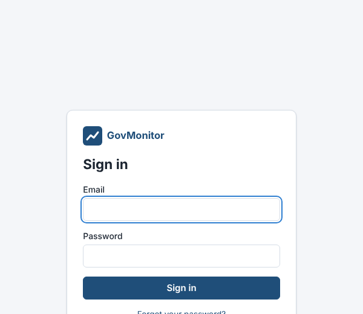

Sign in with your work email and password. The first time, you use the temporary password your
administrator gave you and choose your own (at least 12 characters). After 5 wrong passwords the
account locks for 15 minutes. If your agency turned it on, **Forgot your password?** emails you a
link.

You are signed out after an hour without activity. To add a second step (a 6-digit code from an
authenticator app), open your name at the top right → **Two-step verification**. The same page
lets you stop the daily alert email.

## Read-only users: following results

### The dashboard

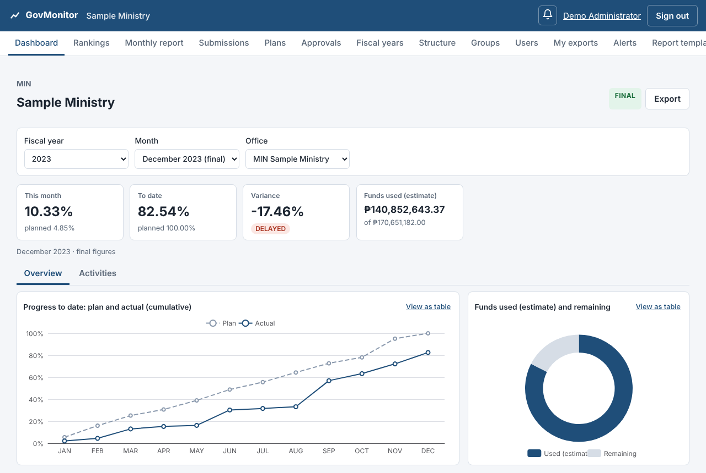

* Choose the **fiscal year**, the **month** and the **office**. **FINAL** means the month is locked
  and the figures will not change; **PROVISIONAL** means offices can still report.
* **This month** and **To date** compare what was planned with what was done; **Variance** is the
  difference in percentage points, with the status word (ahead, on time or delayed).
* **Funds used** is an estimate (budget × accomplishment) unless offices enter amounts actually
  spent.
* The curve shows cumulative plan and actual for the year; the doughnut shows funds used and left.
  Every chart has **View as table**.
* Below are the offices beneath the selected one: click one to go down; the path at the top takes
  you back up.

### Activities and their history

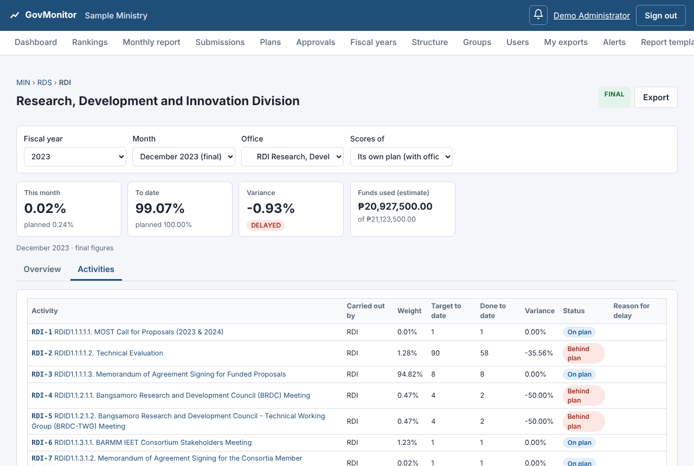

The **Activities** tab lists every activity behind the figures, with its target to date, what was
done and whether it is ahead of, on, or behind plan. Click an activity to see each month — planned,
done, remarks, the reason for any delay — and its supporting files.

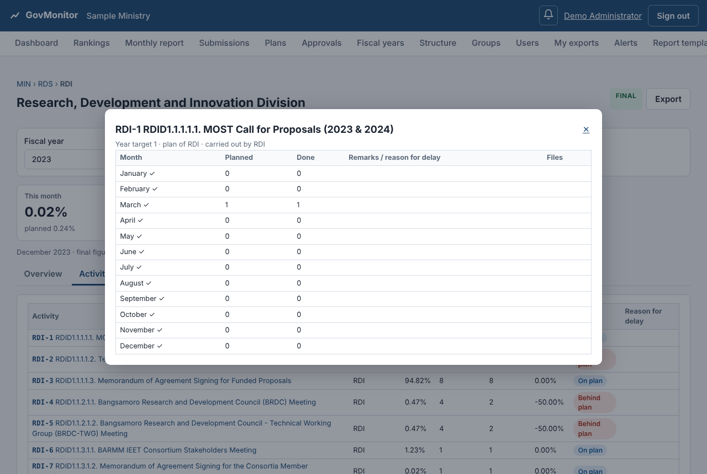

### Rankings

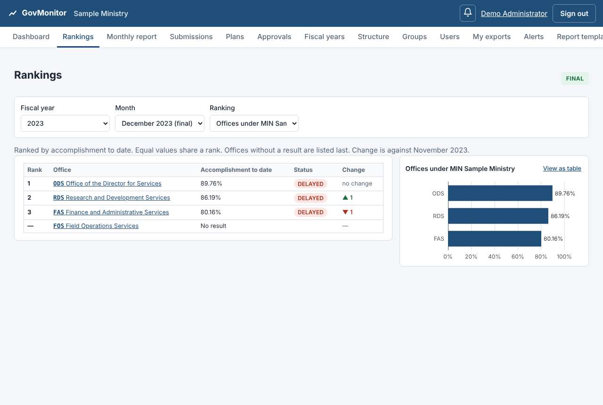

Offices under the same parent, and offices in a group (for example field centers), are ranked by
accomplishment to date. Equal values share a rank (1, 1, 3); offices without results are listed
last. The arrows show the change since the previous month.

### Exports

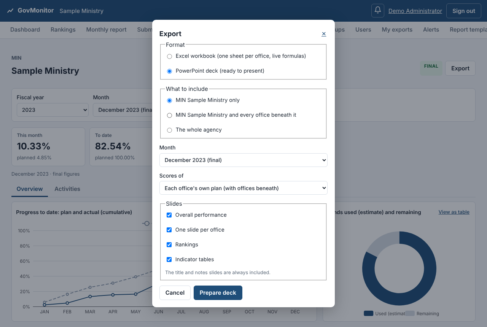

**Export** on the dashboard prepares an **Excel workbook** (one sheet per office in the agency's
workbook layout, with live formulas, plus a summary) or a **PowerPoint deck** (title, overall
results, one slide per office, rankings, indicators). Choose one office, an office and everything
beneath it, or the whole agency, and the month. The file is prepared in the background; it stays
under **My exports**.

### Notifications

The bell at the top shows unread alerts: reports due, late reports, offices behind plan after a
month is locked. Click one to go to the right screen.

## Office administrators: plans and monthly reports

### Entering the plan

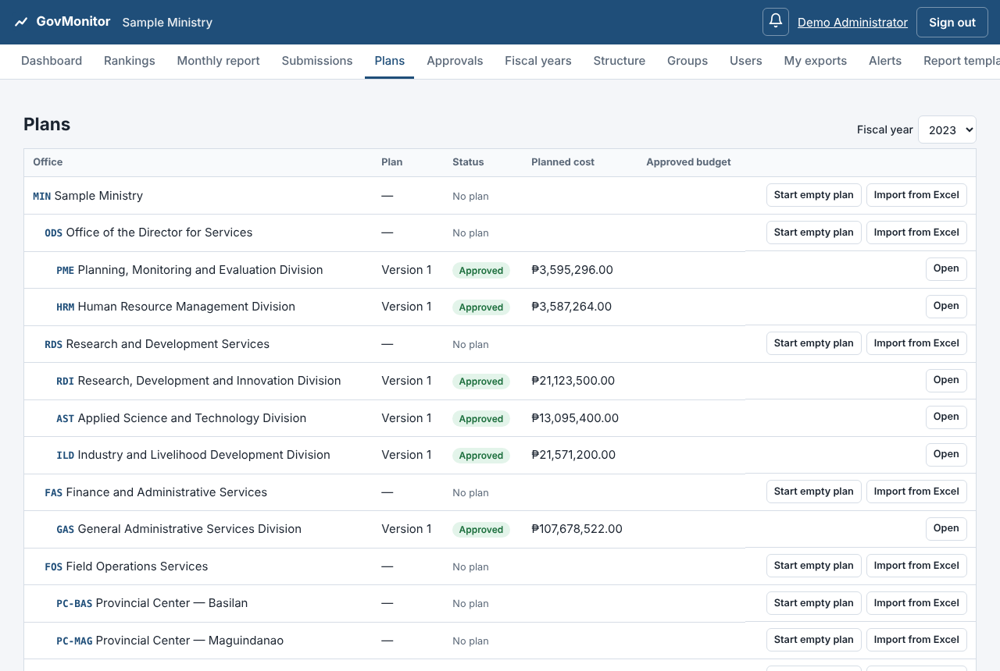

**Plans** lists every office for the selected fiscal year. For your office choose **Start empty
plan**, **Copy from** last year, or **Import from Excel** (download the template, fill it in, upload
it; every problem is listed with its row and nothing is imported until all are fixed).

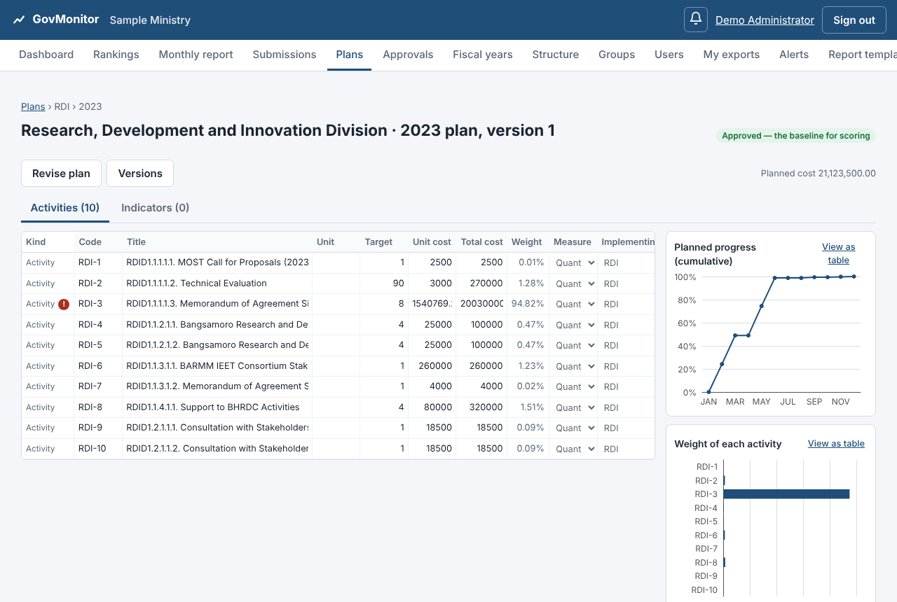

The plan editor works like a spreadsheet: outcomes, outputs, programs and projects as outline rows;
activities with their target, unit, cost and monthly targets. Paste blocks from Excel; arrow keys
and Tab move between cells; Ctrl+Z undoes. The result preview shows the plan's weights as you type.
When it is ready, **Submit for approval**: anything that must be fixed first is listed (for example
monthly targets that do not add up to the year's target). Once approved, the plan is the baseline;
a change later is a **revision** (a new version, approved again).

### Every month

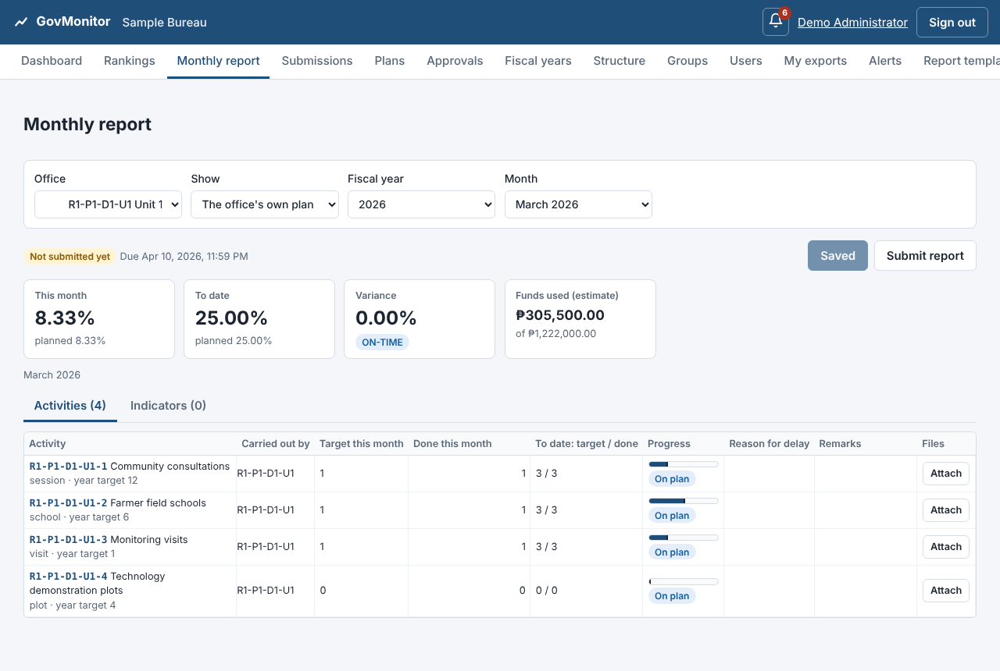

**Monthly report** shows your office's activities for the month: the target, what you type as done,
progress to date and whether you are on plan. For an activity behind plan, give the **reason for
delay**. **Attach** adds supporting files (PDF, photos, Word, Excel, PowerPoint, up to 25 MB). The
tiles at the top show your office's result live, including what you have not saved yet.

**Save** keeps your work; **Submit report** sends the month to the agency administrator before the
cutoff shown at the top. A returned report comes back with a note; fix it and submit again. Leaving
the page with unsaved changes asks first.

## Agency administrators

Everything above, plus:

* **Setup** (first sign-in): name the levels, create the top office and the offices beneath, then
  add users. **Structure** and **Groups** change the tree and the comparison groups later.
* **Users**: add people, give each an office and a level — **admin** (can enter and change data
  for that office and everything beneath) or **read-only** — and reset passwords. The last agency
  administrator cannot be removed.
* **Fiscal years**: create the year, open it, move a month's cutoff if needed.

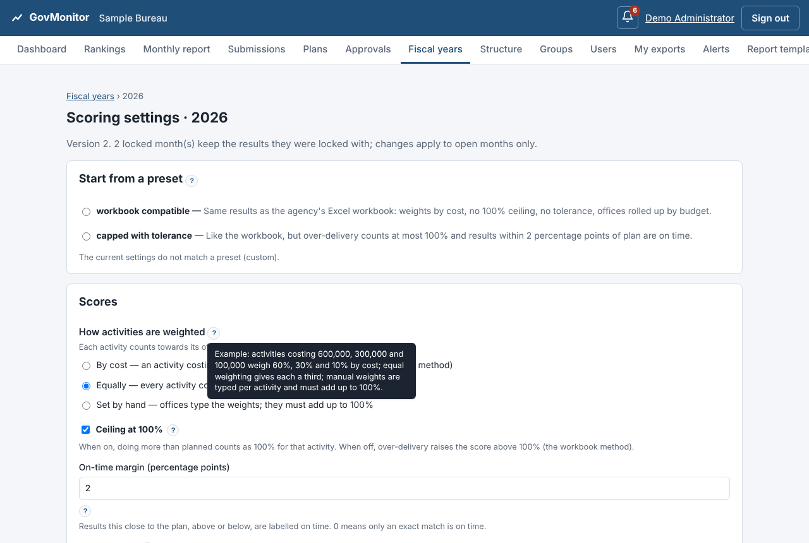

* **Scoring settings** (from the fiscal year): start from a preset — *workbook compatible* gives
  the same numbers as the Excel monitoring workbook — then adjust weighting, the 100% ceiling, the
  on-time margin, status words, roll-up, ranking and the monthly cutoff day. Hover or tap **?** for
  an example of each. Changes never alter months already locked.
* **Approvals**: approve submitted plans (or return them with a note).

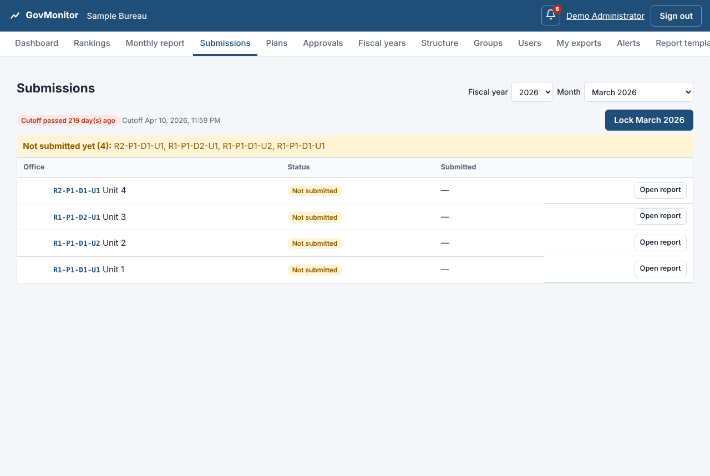

* **Submissions**: which offices have reported this month. Return a report with a note, then
  **Lock** the month when it is complete — its results become FINAL everywhere. Months lock in
  order; **Unlock** needs a reason and is recorded.
* **Alerts**: reminder days before the cutoff, the delay threshold for alerts, and the daily email.
* **Report template**: the deck's title, colours, footer and logo.
* **Audit log**: every change — who, what, when, before and after — with filters and CSV export.

## On a phone

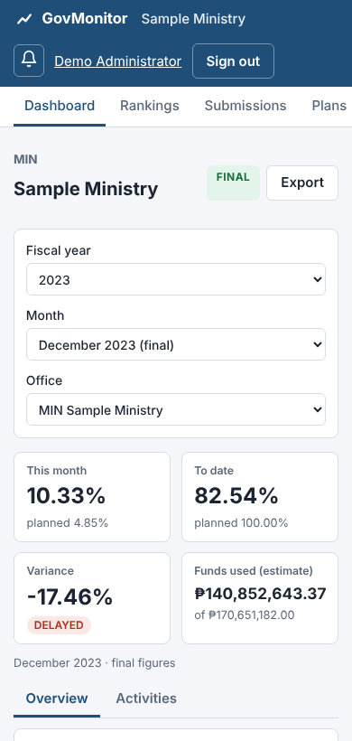

On a phone you can follow the dashboard, rankings and notifications, export files, and attach
photos: open an activity from the dashboard's **Activities** tab and use **Take photo** on the
month. Editing screens (plans, the monthly grid, structure, users, settings) ask you to use a
computer.

## Words used

| Word | Meaning |
|---|---|
| Plan, version | An office's activities and targets for a fiscal year; each approved change is a new version. |
| Activity | A plan line with a yearly target, a cost and monthly targets. |
| Accomplishment, actual | What was done in a month. |
| Cumulative plan / actual | Share of the year's work planned / done up to the month. |
| Variance | Cumulative actual minus cumulative plan, in percentage points. |
| Cutoff | The day by which a month's report is due. |
| Locked, FINAL | The month's results are frozen. PROVISIONAL means it is still open. |
| MOV | Means of verification: a supporting file (photo, scan, document). |
| Owner / implementing office | The office whose plan holds an activity / the office that carries it out. |
| Roll-up | How a parent office's result is built from its offices' results (by budget, by default). |
