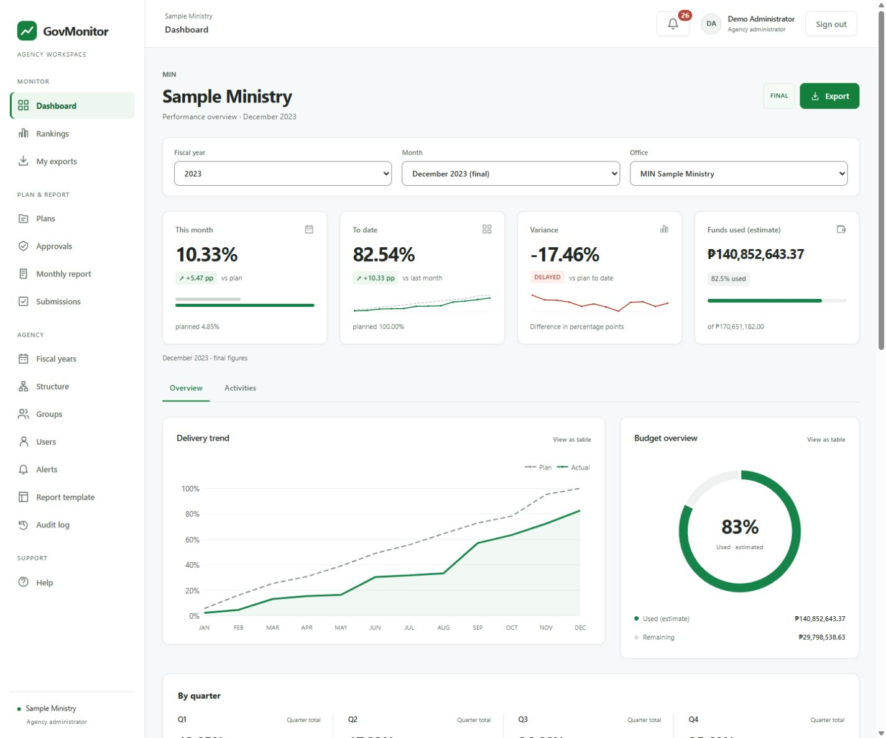
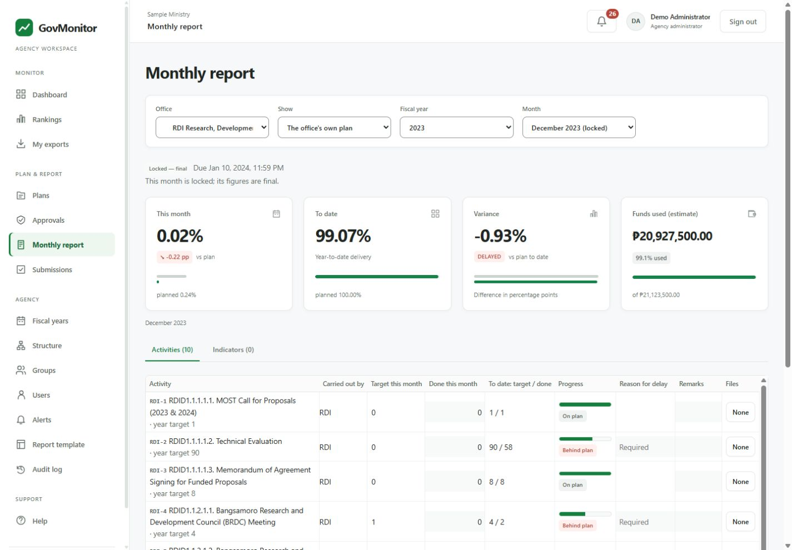
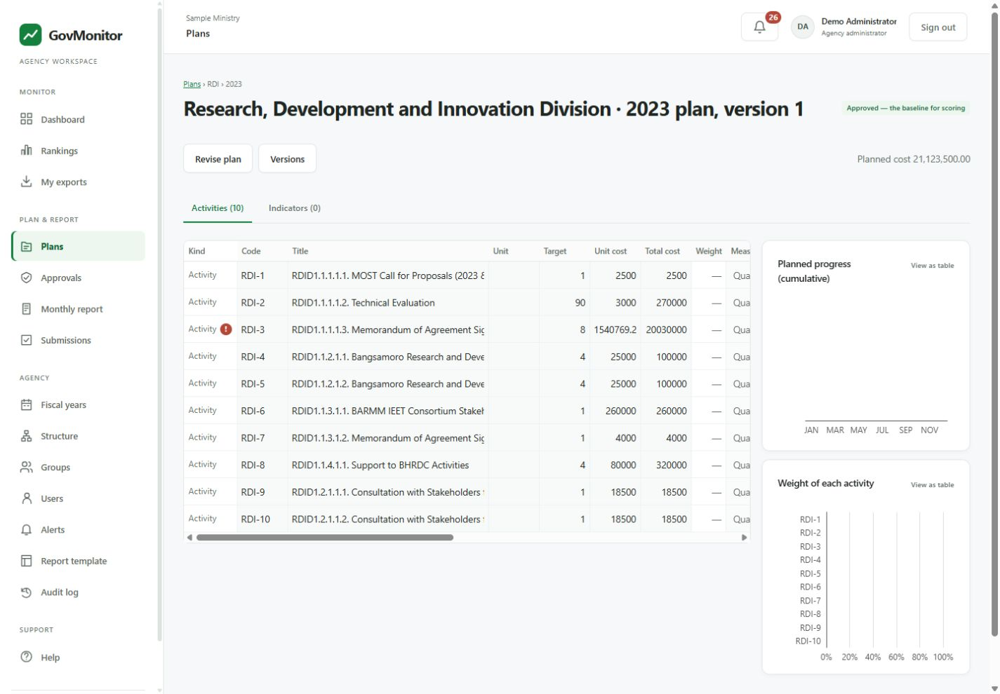
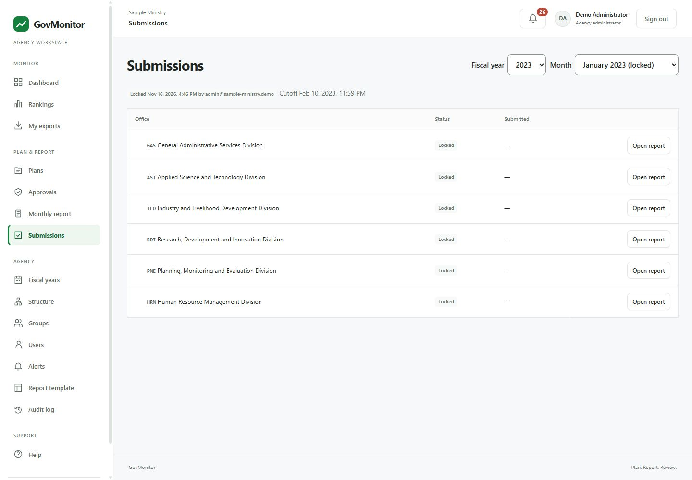
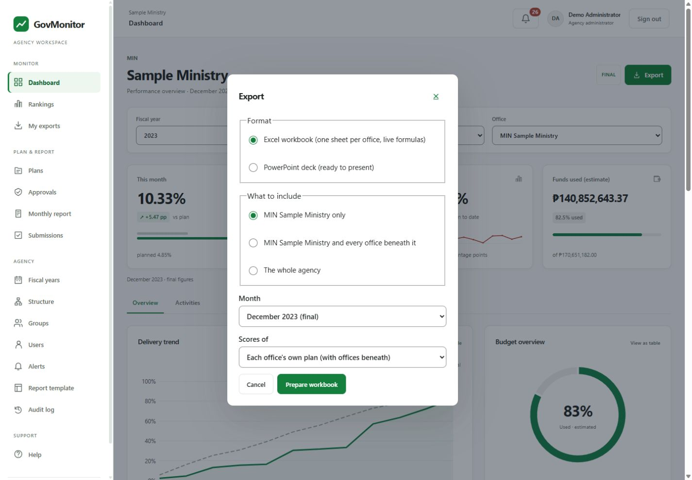
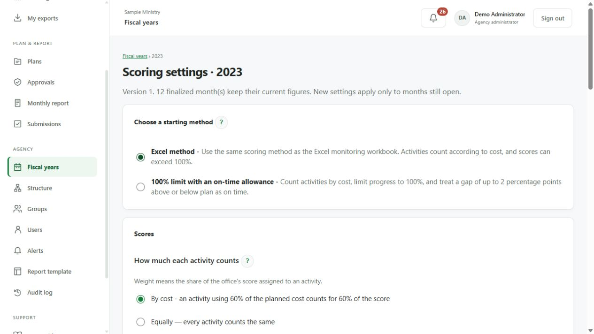

# GovMonitor
## Detailed User Guide & SOP

Edition 3.0 | 21 November 2026

For first-time office staff, reviewers, managers, and agency administrators.

## Contents

1. [Overview & Roles](#overview--roles)
1. [Step-by-Step: The Monitoring Routine (Start Here)](#step-by-step-the-monitoring-routine-start-here)
1. [Over-All Performance Presentation for the Year](#over-all-performance-presentation-for-the-year)
1. [Word List: Plain Meanings](#word-list-plain-meanings)
2. [Getting Started: Sign In & Password Help](#getting-started-sign-in--password-help)
3. [Account Security & Personal Email Alerts](#account-security--personal-email-alerts)
4. [Your Workspace: Navigation & Shared Controls](#your-workspace-navigation--shared-controls)
5. [First-Time Agency Setup](#first-time-agency-setup)
6. [Dashboard: Filters, Results & Office Detail](#dashboard-filters-results--office-detail)
7. [Activities & Monthly History](#activities--monthly-history)
8. [Rankings](#rankings)
9. [Plans: Start, Copy & Import](#plans-start-copy--import)
10. [Plan Editor: Buttons & Row Arrangement](#plan-editor-buttons--row-arrangement)
11. [Plan Editor: Fields & Indicators](#plan-editor-fields--indicators)
12. [Approvals, Revisions & Version History](#approvals-revisions--version-history)
13. [Monthly Report: Enter, Save & Submit](#monthly-report-enter-save--submit)
14. [Supporting Files: Add, Read & Remove](#supporting-files-add-read--remove)
15. [Submissions: Review, Return, Lock & Unlock](#submissions-review-return-lock--unlock)
16. [Fiscal Years & Monthly Deadlines](#fiscal-years--monthly-deadlines)
17. [Scoring Settings: Scores & Comparisons](#scoring-settings-scores--comparisons)
18. [Scoring Settings: Monthly Reporting Rules](#scoring-settings-monthly-reporting-rules)
19. [Structure: View & Manage Offices](#structure-view--manage-offices)
20. [Bulk Office Entry & Comparison Groups](#bulk-office-entry--comparison-groups)
21. [Users: Accounts, Access & Password Resets](#users-accounts-access--password-resets)
22. [Export: Excel, PowerPoint & My Exports](#export-excel-powerpoint--my-exports)
23. [Notifications & Agency Alert Settings](#notifications--agency-alert-settings)
24. [Report Template: Presentation Appearance](#report-template-presentation-appearance)
25. [Audit Log, Help & Phone Use](#audit-log-help--phone-use)
26. [End-to-End SOP: Prepare & Approve a Yearly Plan](#end-to-end-sop-prepare--approve-a-yearly-plan)
27. [End-to-End SOP: Enter, Prove & Review January](#end-to-end-sop-enter-prove--review-january)
28. [End-to-End SOP: Finalize, Download & Correct Later](#end-to-end-sop-finalize-download--correct-later)
29. [Quick Troubleshooting & Status Reference](#quick-troubleshooting--status-reference)
30. [Optional Platform Area: Manage Agencies](#optional-platform-area-manage-agencies)
31. [Screenshot Reference: Dashboard & Reporting](#screenshot-reference-dashboard--reporting)
32. [Screenshot Reference: Plan & Review](#screenshot-reference-plan--review)
33. [Screenshot Reference: Export & Scoring](#screenshot-reference-export--scoring)
34. [Read the User Guide](#read-the-user-guide)

<!-- page -->

## Overview & Roles

GovMonitor helps government offices compare their planned work with what they complete each month. Staff prepare yearly plans and monthly reports; reviewers check them, finalize the month, and share the results.

This guide explains the screens, editable fields, buttons, links, choices, and confirmation messages. Labels in **bold** match the app. Some controls appear only for the person allowed to use them or when a record reaches the right stage.

| Role | Responsibility and access |
|---|---|
| Read-only user | Read results, open activity histories and files, and download reports for assigned offices and the offices beneath them. Cannot enter or approve work. |
| Office administrator | Prepare plans, enter accomplishments, attach proof, and submit reports for assigned offices and those beneath them. Can also report activities assigned to their office by another office. |
| Agency administrator | Complete setup; manage offices, people, years, scoring, and reminders; approve plans; return reports; lock and unlock months. |
| Platform owner (separate area) | Create and manage agencies and their first administrators. This is separate from the agency workspace. See the final section. |

### The reporting cycle

**Simplest way:** the monitoring administrator follows **Step-by-step** and enters everything. Otherwise: prepare the agency and year. Prepare a plan. Submit and approve the plan. Enter the month's completed work. Save and attach proof. Submit the monthly report. Review and correct it. Lock the month. Check and download final results.

**Save, submit, and lock are different:** Save keeps your entries. Submit sends them for review and stops editing. Lock freezes a month's results for the whole agency.

### About this edition

This edition describes the updated navigation and controls. Actual screenshots of the redesigned app appear at the end. They show the Sample Ministry training data, which differs from the worked example in this guide.

**Start here:** First-time users should read Getting Started, Your Workspace, and the section for their task. Agency administrators should also read Setup, Fiscal Years, and Scoring Settings before opening reporting.

<!-- page -->

## Step-by-Step: The Monitoring Routine (Start Here)

**Who:** The monitoring administrator (agency administrator) — the one person who enters everything. **Open:** the start page, or **Step-by-step** at the top of the menu.

You do not need the offices to sign in. Collect the figures from the offices you handle (for example your provincial offices and divisions), then type them in here. The page shows a **progress bar** with six numbered steps. A green tick means the step is done; the ringed number is the step you are on. Select any step to jump to it, or use **Next** and **Back** at the bottom.

| Step | What to collect from the offices first | What to do in the app | Done when |
|---|---|---|---|
| 1. Offices | The names of the offices and which office is under which | **Open the offices** (or **Use the setup wizard** the first time) | Your offices are listed |
| 2. Year | The year to monitor | **Add the year**; the app creates its twelve months | A year exists |
| 3. Plans | Each office's work and financial plan: activities, target number per month, cost, output targets | For each office: **Start plan**, type the plan (or import the Excel template), then **Mark as final** | Every office's plan is **Final** |
| 4. Monthly results | Each office's accomplishment report, reasons for delays, proof if required | For each office: **Enter results**, type what it did, **Save**, then **Submit report** | Every office shows **Done** for the month |
| 5. Check & close | — | **Open the dashboard**, check the figures, then **Close** the month | The month is **closed** (final) |
| 6. Report | — | **Over-all performance for the year** or **Monthly report** | — |

Choose the **Year** and **Month** at the top of the page; the checklist follows your choice. While you work on a page that belongs to a step (for example Office plans or Monthly results), a green bar at the top shows **Step N of 6** with **Back to the steps** and **Next** links, so you always know where you are.

**Mark as final** confirms a plan in one go (it is submitted and approved at once). Other people's accounts, approvals and returns still exist under **Settings** for agencies that want offices to enter their own figures, but you do not need them.

<!-- page -->

## Over-All Performance Presentation for the Year

**Who:** Agency administrator and anyone who can export the whole agency. **Open:** step 6 of **Step-by-step** → **Over-all performance for the year**, or **Export** on the dashboard → **Over-all performance for the year (PowerPoint)**.

Choose the month the figures are **as of** (usually December), and type the **Title on the first slide**, for example *Ministry's over-all performance*. The presentation follows the agency's year-end slides:

| Slide | What it shows |
|---|---|
| Title | Agency, your title, "As of December 31, 2023" (the last day of the chosen month) |
| Over-all | Two panels. **Based on activities (PPAs):** plan, actual, gap, status, funds remaining (% and amount) and the S-curve with plan, actual and gap lines. **Based on output indicators:** target, share reached, gap, status and a month-by-month line. Underneath, one small panel per office directly beneath (for example Operations, Support to Operations, General Administration). |
| Offices beneath | For every office that has offices under it: a small panel per office — plan, actual, gap, status, funds remaining, output targets reached. |
| Each office | Its dashboard (tiles, S-curve, funds), its **activities by month** (dark cell = month planned, with the planned number; yellow cell = month with an accomplishment, with the number done) and its output indicators. |
| Rankings | **Based on activities** and **based on output indicators**, for each set of offices compared together (offices under the same parent and your office groups). Sets where nobody has a result yet are left out. |
| Closing | Thank you. |

Colours and the logo come from **Settings → Report look**. The file waits under **Downloads**.

<!-- page -->

## Word List: Plain Meanings

The same list is on **Help and word list**.

| Word in the app | Meaning |
|---|---|
| Plan | What an office said it would do this year: its activities, how many each month, and their cost. |
| Activity (PPA) | One piece of planned work — a program, project or activity — with a yearly target number. |
| Actual | What the office really did, as reported each month. |
| Plan % / Actual % (total so far) | How much of the year's work should be done by this month, and how much is done. Bigger, costlier activities count for more. Older screens call this *cumulative*. |
| Gap | Actual minus plan (also called *variance*). Below zero = behind plan. |
| Status | ADVANCED (ahead), ON-TIME, or DELAYED (behind), from the gap. |
| Output indicator / output target | A result counted over the year, such as "number of teachers trained", with a yearly target. |
| Funds remaining | Budget not yet used, estimated from the work done or from amounts entered. |
| S-curve | Line chart of plan and actual, total so far, month by month. |
| Close the month | Makes a month's figures final (older name: *lock*). Reopen needs a reason. |
| Proof (MOV) | Supporting files such as photos or signed reports. |
| Change history | Who changed what and when (older name: *audit log*). |

**Menu names in this edition:** Step-by-step (new), Downloads (was My exports), Office plans (Plans), Monthly results (Monthly report), Who has reported (Submissions), and under **Settings**: Offices (Structure), Office groups (Groups), Years (Fiscal years), Users, Plans to approve (Approvals), Reminders (Alerts), Report look (Report template), Change history (Audit log). Sections further down may still use the older names.

<!-- page -->

## Getting Started: Sign In & Password Help

**Who:** Everyone. **Open:** The website address supplied by your agency administrator; the local test address is http://localhost:8000.

1. Obtain your account email and temporary password from your agency administrator. There is no public registration button.
2. Enter **Email** and **Password**, then select **Sign in**. The button briefly changes to **Signing in.** while it checks your details.
3. On first sign-in, enter the **Temporary password**, a **New password**, and **Repeat the new password**. Select **Save password**. Use at least 12 characters; do not use a common password or only numbers.
4. If a second check appears, enter the six-digit **Code** from your phone's sign-in app and select **Verify**.
5. Check the agency name and your office before entering data.

| Control or message | What it does / what to do |
|---|---|
| Email / Password | Enter your assigned details. Pasting and password managers are allowed. |
| Sign in / Verify | Check the information and continue. Do not repeatedly press while it is checking. |
| I lost my phone - use a recovery code | Switch from the phone code to one unused recovery code saved when you enabled the second check. Each recovery code works once. |
| Use a code from my app instead | Switch back to the six-digit phone code. Switching clears the code field. |
| Forgot your password? | Open password help. Enter your account email and select Send reset link. Email delivery must be enabled by the agency. |
| Back to sign-in | Return without changing your password. |
| Reset link from email | Open the link, enter the new password twice, select Save password, then Sign in. If the link is rejected, request a fresh one. |
| Your session ended because it was idle | Sign in again. Unsaved entries may need to be re-entered. The usual idle limit is 60 minutes, but the agency can change it. |

After five wrong passwords, wait 15 minutes before retrying. If email help is unavailable or you have no recovery code, contact the agency administrator. A reset password is temporary and must be changed at your next sign-in.

**Success:** You see your agency workspace, or the first-time setup screen if your agency still needs setup.

<!-- page -->

## Account Security & Personal Email Alerts

**Who:** Everyone. **Open:** Select your name in the top bar. The page is titled **Sign-in security**.

| Section / control | Explanation and action |
|---|---|
| Password / Change your password | Open the password form. Enter Current password, New password, and Repeat the new password; select Save password. If you opened it voluntarily, Cancel returns to account security. |
| Set up two-step verification | Start an extra sign-in check using a phone app. A square scan code and a written setup key appear. |
| Scan code / written key | Add this account to your phone's sign-in app by scanning or typing the key. These are private setup details, not buttons for sharing. |
| Enter the 6-digit code / Turn on | Enter the current phone code, then Turn on. The button becomes available when six digits are entered. |
| Recovery codes | Save them privately when they appear. They are shown once; each can replace a phone code for one sign-in. |
| Your password, to turn it off | Enter your current password if you need to stop the second check. |
| Turn off two-step verification | Remove the phone-code requirement after your password is checked. Use only when needed and follow your agency's account rules. |
| Email alerts checkbox | Choose whether you receive a daily email of new notifications. This choice saves immediately; there is no separate Save button here. It does not stop notifications inside the app. |

Enabling personal email alerts does not enable email for the agency. If the agency has no email service, use the bell inside the app.

**Success:** The second-check status reads **on** or **off**, and your email preference remains selected after reopening the page.

<!-- page -->

## Your Workspace: Navigation & Shared Controls

**Who:** Everyone. The desktop workspace uses a left-side menu. On smaller screens select **Menu** to reveal it; **Close menu** hides it. Selecting a destination closes the small-screen menu.

| Group / control | Destinations or result |
|---|---|
| Start here | **Step-by-step** (agency administrator): the guided routine with the progress bar. It is also the administrator's start page. |
| See results | Dashboard, Rankings, and Downloads. Use these to follow and share results. |
| Enter data | Office plans, Monthly results, and Who has reported (agency administrator). |
| Settings (select to open) | Offices, Office groups, Years, Users, Plans to approve, Reminders, Report look, and Change history. Management choices depend on your role. |
| Help / Help and word list | Short instructions by role and the plain meanings of the words used. |
| Support / User guide | Search the complete guide, read any section, print it, or download the PDF. |
| GovMonitor name and logo | Return to the start page. This usually shows the dashboard or setup reminders. |
| Agency name and page name | Confirm where you are working. These headings do not switch agencies. |
| Bell | Open recent notifications. The number shows unread items. |
| Your name | Open Sign-in security and personal email preferences. |
| Sign out | End your current sign-in and return to the sign-in screen. Save work first. |
| Start the setup | Appears on the start page when an agency administrator still needs to complete agency setup. |
| Skip to content | Appears when reached with the keyboard. Jump past navigation to the main screen. |

### Controls used throughout the app

**Dropdowns** choose an office, year, month, or view. **Tabs** such as Overview and Activities change the part of the current screen shown. **Checkboxes** turn a choice on or off; **radio choices** select one option from a set.

**Save** keeps edits. **Saved** usually means there are no new edits to save. **Cancel** closes a form without completing its action. The **Close** control (shown as a small X in some screens) or **Escape** closes a popup; clicking outside a popup also closes it. In a popup, Tab and Shift+Tab move between its controls.

An **OK/Cancel confirmation** asks before a consequential action. Read the office, month, and consequence; Cancel stops it. A **note/reason prompt** requires an explanation; cancelling or leaving it empty stops the action. Closing a confirmation is not the same as saving.

Use **Tab** to move between controls, **Shift+Tab** to go back, and **Enter/Space** to activate the focused control. Wide tables scroll sideways inside their frame. A faint, unavailable control needs a condition met first; check your role, selected record, and status.

<!-- page -->

## First-Time Agency Setup

**Who:** Agency administrator. **Open:** **Start the setup** on the start page. Complete the four steps of **Set up your agency** on a computer.

| Step / control | What to enter and what it does |
|---|---|
| Level names | Name the office levels from top to bottom, such as Ministry, Service, Division. At least the top name is needed. |
| Add a level | Add another level-name field. This does not create an office by itself. |
| Next | Save this step and move forward. |
| Top office: Name / Code | Enter the agency name and a short code. Reports use this name. This step renames the agency's existing top office. |
| Back | Return to the preceding step. Previously saved information stays saved. |
| Offices | Paste offices one per line: code, a tab or " - ", then name. Indent a line to place it beneath the office above. Review any line-number messages. |
| Add offices and continue | Check and save the pasted offices, then continue. Fix listed errors before proceeding. |
| Skip | Leave the office list empty for now and continue. Add offices later through Structure. |
| First users: Email / Full name | Enter the person who will use the account. |
| Office / Level | Assign the correct office and choose Admin for entry or Read-only for viewing. An office assignment also covers offices beneath it. |
| Add user | Create that person and show their temporary password once. Give it to them privately. Repeat for each person. |
| Finish setup | Mark the four-step setup complete and return to the start page. |
| Go to the start page | Leave setup. Completed, saved steps are kept. Return to finish if needed. |

**Next task:** Open **Fiscal years** separately to create the reporting year and check its scoring settings. Finishing the four setup steps does not itself create a year or approve an office plan.

**Checkpoint:** Every office has the correct place in Structure and at least one person able to enter its data. Do not give Admin access when someone only needs to read results.

<!-- page -->

## Dashboard: Filters, Results & Office Detail

**Who:** Everyone, within assigned offices. **Open:** **Monitor > Dashboard**.

| Control / section | What it means and how to use it |
|---|---|
| Fiscal year / Month | Choose the reporting year and month. Check both before comparing figures. Final months are marked. |
| Office | Choose the office whose results you want to see. Indented names are beneath another office. |
| Scores of | When available, choose Its own plan (with offices beneath), or Activities it carries out. The second view follows who does the work, even if another office owns the plan. |
| Office path above the title | Select an earlier office code to return to a higher office. The final code identifies the current office. |
| FINAL / NOT FINAL | Final means the month is locked. Provisional means figures may still change. These are status labels, not actions. |
| This month | The share of the year's work completed in the selected month, with the planned share below it. It is not simply a count of activities. |
| To date | Progress from the year's start through the selected month, compared with the plan for the same months. |
| Comparison badges | The badge below This month compares actual progress with the month's plan. The badge below To date compares progress with the previous month, when both months have figures. The change is in percentage points: moving from 40% to 45% is a gain of 5 points. |
| Small lines and bars | Small lines show recorded progress or the gap from the plan through the chosen month; missing figures leave gaps. Paired bars compare the plan with completed work. These are pictures, not buttons. |
| Variance | The difference between progress and plan, with a word showing ahead, on time, or delayed. The agency can change the wording and the allowed on-time margin. |
| Funds used | Spending information. If marked estimate, it is calculated from planned funds and progress; it is not proof of money actually paid. |
| Overview | Show the progress chart, funds chart, available quarterly information, and lower-office summaries. |
| Activities | Show the work behind the score. Select an activity name for its monthly history. |
| By quarter / Quarter details | Read each quarter's completed share, target, and difference. Select Quarter details to open the full figures; select it again to hide them. |
| Lower-office names | Open that office's dashboard. Use the office path to go back up. |
| All rankings | Open Rankings from the dashboard comparison summary. |
| Export | Prepare an Excel workbook or PowerPoint report for the chosen offices and month. |

### Read the dashboard charts

**Delivery trend** compares the year's planned and completed work up to each month. The green line shows completed work; the dashed gray line shows the plan. **Budget overview** compares used and remaining funds; the middle number is the share used. An estimate is labelled, and a missing budget is shown as No budget. Quarterly and ranking sections appear when data is available. Hover over a chart point for details; select a legend entry where available to hide or show that line.

**View as table** replaces a chart with its figures. **View as chart** returns to the picture. This is a viewing change; it does not alter data. Read table figures when precise numbers are needed.

If the screen says there is no approved plan or result, first check the year, office, and month. A blank result is not the same as zero completed work.

**Screenshot reference:** See Dashboard & Reporting at the end for the updated filters, result cards, charts, and Export button.

*Sample Ministry: compare the green completed-work line with the dashed plan line. Use Export to prepare a report for the selected month and office.*

<!-- page -->

## Activities & Monthly History

**Who:** Everyone who can view the activity. **Open:** **Dashboard > Activities**, then select an activity's code or title.

| Item / control | Explanation |
|---|---|
| Activity title | Open that activity's history. This does not open the plan editor. |
| For office / Carried out by | Identify the office owning the plan or the office responsible for doing the work, according to the view selected. |
| Weight | How much this activity contributes to the office score. It is not an accomplishment field. |
| Target to date / Done to date | Work planned and completed through the selected month. |
| Variance / Status / Reason for delay | See whether the activity is keeping up and any explanation for the delay. |
| History month rows | Read each month's Planned, Done, Remarks / reason for delay, and Files. A blank actual may mean nothing has been entered. |
| Supporting filename | Open or download that file. Check that it belongs to the correct month. |
| Take photo | On a phone, offer the camera for a month where you can attach files. Allow camera access if you choose to take a photo. |
| Choose file | Choose an existing supporting file for an editable month. On supported phones this appears with Take photo. |
| Close / Escape | Close the history and return to the activity list. |

Read-only users can inspect files but cannot add them. Attachment choices disappear when the underlying report is submitted or the month is locked. If an activity belongs to another office's plan, the owning office's report status still controls whether it can be changed.

The history is primarily for checking results. Use **Monthly report** on a computer to change completed quantities, remarks, or delay explanations. Adding a photo does not submit the report.

<!-- page -->

## Rankings

**Who:** Everyone, within their assigned offices. **Open:** **Monitor > Rankings**.

| Control / column | Explanation |
|---|---|
| Fiscal year / Month | Choose the same period used in the dashboard or report you are comparing. |
| Ranking | Choose offices beneath a shared parent, or a named group created by the agency administrator. Group choices begin with Group. |
| Office name or code | Open that office's dashboard for the selected month. |
| Rank | Position according to the agency's chosen comparison rule. Equal values share a position, such as 1, 1, 3. |
| Result value | May show accomplishment to date, accomplishment minus plan, or accomplishment as a share of plan. Read the explanation above the table. |
| Status | Whether the office is ahead of, on, or behind its plan. A high rank alone does not mean it met its target. |
| Change | Movement compared with the previous month when that comparison is available. |
| Bar chart / View as table / View as chart | Compare visually or read the same figures as a table. |
| FINAL / NOT FINAL | Whether the selected month's figures are frozen. |

Offices without a result are listed last and show **No result**. If there is nothing to rank, the selected offices may not have at least two offices beneath them and no comparison group may exist. Ask the agency administrator to check the structure or groups.

**Routine:** Choose year, choose month, choose ranking, read the comparison rule, then open any office that needs a closer review. Always compare the same month and kind of score.

<!-- page -->

## Plans: Start, Copy & Import

**Who:** Everyone can view allowed offices; office and agency administrators prepare plans. **Open:** **Plan & report > Plans**.

| Control / status | Explanation and result |
|---|---|
| Fiscal year | List plans for that year. An office can have several saved versions, but only one approved version is in force. |
| Start empty plan | Create the first draft for the office, then open the editor. Available when no current plan is offered for that office and you can edit it. |
| Copy from [year] | Use an available approved plan from the preceding year as a starting draft. Review dates, targets, costs, and responsible offices before submitting. |
| Import from Excel | Open the file-import window for this office and year. It creates a draft; it does not approve it. |
| Edit / Open | Enter the editor or read a plan according to your access and its status. |
| Draft | Being prepared; authorized staff can edit it. |
| Waiting for approval | Submitted and protected from further editing until returned. |
| Approved | The plan used for reporting and scoring. |
| Replaced | An older approved version replaced by a later version. Kept for reference. |

### Import-window controls

Select **import template** to download the correct layout, or use an exported office sheet as described in the window. Fill it in, save it as an Excel file, choose it under **Excel file (.xlsx)**, and select **Import**. Check the office and year in the window title first.

**Waiting / Preparing.** means the file is being read. If it fails, read **Problems to fix** by row and column, correct the spreadsheet, then select **Try another file**. No plan is imported when an error blocks the file. **Worth checking** lists warnings that still need review.

After success select **Open the draft plan**, check every row, save any changes, and submit it for approval. **Cancel**, the close control, or Escape closes the import window. Progress can also be checked under **My exports**.

<!-- page -->

## Plan Editor: Buttons & Row Arrangement

**Who:** Office or agency administrator for editable drafts; others can view allowed plans. **Open:** **Plans > Edit/Open**.

The heading shows office, year, and version. Read the status before editing. The **Plans** path returns to the plan list. Scroll sideways within the table to reach all 12 months.

| Control | What it does / when to use it |
|---|---|
| Save / Saved | Keep draft edits. Saved means no new edits are waiting. A preview changing does not save the plan. |
| Submit for approval | Save pending edits, check the plan, and send it to the agency administrator after confirmation. Fix every blocking problem listed. |
| Approve / Return for correction | Agency-administrator controls on submitted plans. Approval sets the plan in force. Return requires a note and allows corrections. |
| Revise plan | On an approved plan, create a new draft version after confirmation. The existing approved plan remains in force until the revision is approved. |
| Versions | Open saved-version history and comparisons. |
| Activities / Indicators tabs | Switch between work activities and additional measures of results. Both belong to the same plan. |
| New row | Choose Outcome, Outcome indicator, Output, Output indicator, Program, Project, or Activity. These arrange work from broad aims to individual tasks. |
| Add at end / Add below selected | Insert the chosen row type. Select an existing row first if the new row belongs below it. |
| Indent / Outdent | Change the depth of an organizing row. These do not operate on an Activity row. |
| Move up / Move down | Move the selected row one place. Check the outline after moving; row order determines which heading contains an activity. |
| Delete row | Remove the selected row from the draft. Check the selected title first; this change is kept when you save. |
| Undo | Reverse the most recent unsaved table edit. It is unavailable when there is no edit to reverse. |
| Problem summary / row problem mark | Expand or collapse the problem list; point to a row mark to read what needs checking. |
| Preview charts / View as table | Review planned progress and how much activities count toward the score. These are not editing controls. |

**Keyboard:** Tab and arrow keys move through activity cells; Enter moves down. Ctrl+S saves, Ctrl+Z undoes. You can paste a rectangular block from Excel starting at the selected cell. Verify the pasted columns before saving.

**Success:** The plan saves, all blocking problems are corrected, and its status becomes Waiting for approval after submission.

<!-- page -->

## Plan Editor: Fields & Indicators

**Open:** An office's plan. Select **Activities** or **Indicators**. A title or heading row organizes work; an Activity row holds the figures used for accomplishment reporting.

| Activity field | What to enter |
|---|---|
| Code | A short identifier. Use distinct codes within the plan. |
| Title | A clear activity name; heading rows need meaningful titles too. |
| Unit | What you count, such as session, visit, person, or peso. |
| Target | The year's planned amount. Quantity and Money activities need a positive annual target. |
| Unit cost / Total cost | Cost per unit and the whole activity cost. Enter plain numbers; check warnings if the two costs do not agree with the target. |
| Weight | How much the activity counts toward the score. Usually calculated by the agency's cost or equal-share rule; editable when the agency uses weights set by hand. Hand-set weights must total 100%. |
| Measure: Quantity | Count work completed in the unit entered. Monthly targets must add up to the yearly target. |
| Measure: Money | Measure the work target as a money amount. This target is different from the optional Amount spent entry in monthly reports. |
| Measure: Recurring | For repeated work tracked under the agency's recurring-work rule. Confirm its target convention with the agency administrator rather than treating it as a normal yearly count. |
| Implementing office | The office doing the work. It can differ from the office whose plan contains the activity. |
| Monthly columns / Total | Enter each month's planned amount. For Quantity and Money, confirm that the 12-month total matches Target. |

### Indicators tab

Indicators track additional results, such as people served or a service-quality measure. Select **Add indicator** to create a row. Enter **Code**, **Indicator** (name), **Kind** (Output or Outcome), **Unit**, **Annual target**, **Weight** when required, and monthly target values.

Under **Counted as**, choose **Total of the months** for results that add together, or **Latest value** when the latest month's value is the result to show. The X control beside a row, named **Remove indicator** for keyboard readers, removes that indicator from the draft. Use the plan's **Save** button to keep indicator changes.

The right-side charts explain the current draft as you work. **View as chart** and **View as table** only change how you read them. A warning is a request to check a figure; a blocking problem must be fixed before submission.

<!-- page -->

## Approvals, Revisions & Version History

**Who:** Agency administrators approve or return plans. People who can view a plan can inspect its versions. **Open:** **Plan & report > Approvals**, or **Plans > Open > Versions**.

| Section / control | Explanation |
|---|---|
| Fiscal year | Choose which year's plans to review. |
| Waiting for approval | Submitted office plans awaiting a decision. The number shows how many are listed. |
| Review | Open the submitted plan. Check activity names, responsible offices, yearly and monthly targets, indicators, and costs. |
| Approve | Confirm the office and version. The plan becomes the basis of reporting; a previously approved version is replaced. |
| Return / Return for correction | Enter a specific correction note. The office can correct and resubmit the draft. |
| Budget vs planned cost | Compare the approved office budget with the total cost of planned activities. A negative Difference means planned cost is over budget. |
| Approved budget / Save | Enter or update the office's approved allocation and save that row. It is separate from the activity costs in the plan. |
| Revise plan | Start a new draft from the approved plan; update, save, submit, and approve it through the same process. |
| Versions / Version [number] | List past versions or open a particular version. Status and submitted/approved details show its history. |
| Compare with version [number] | Show what was Added, Removed, or Changed compared with the preceding version. Read both version numbers above the comparison. |
| Plans / Plan path links | Return to the list or the plan from version history. |

An approved revision affects open-month scoring. Months already locked keep their frozen results and the version used then. Removing an activity in a revision does not erase accomplishments previously recorded for that activity.

**Success:** The intended version shows Approved. An office does not need to submit its plan every month; monthly accomplishment submission is a separate task.

<!-- page -->

## Monthly Report: Enter, Save & Submit

**Who:** Authorized office or agency administrators enter data; read-only users can inspect allowed records. **Open:** **Plan & report > Monthly report** on a computer.

| Control / field | Explanation |
|---|---|
| Office / Fiscal year / Month | Choose the exact record to update. Verify all three before typing. |
| Go to plans | Open Plans when the screen says the office has no approved plan. |
| Show: The office's own plan | Work listed in this office's approved plan. Use this view to submit the office's report. |
| Show: Activities it carries out for other offices | Work assigned to this office from other offices' plans. Enter allowed activity results here; the owning office manages its report submission. |
| Due date / status | Check the deadline and whether the report is draft, submitted, returned, or locked. |
| Activities / Indicators | Switch between completed work and additional result measures. |
| Done this month | Enter only work completed during this month, in the activity's stated unit. Do not repeat the running total from earlier months. |
| Amount spent | When enabled, enter actual spending for this month. It is optional and separate from Done this month. |
| To date: target / done | Compare running totals through this month. Earlier months are already included. |
| Progress / status | Check whether the activity is keeping up with its plan. |
| Reason for delay | Explain any activity behind its target to date. A missing reason can block submission. |
| Remarks | Record useful context, dates, or explanations for the result. |
| Attach / [number] files / None | Open the supporting-file window for that row. None may appear when there is no file and you cannot add one. |
| Save / Saved | Keep entries without sending the report for review. Wait for the saved message. |
| Submit report | Save outstanding entries, check the report, and submit after confirmation. It cannot be edited unless returned. |
| Return for correction | Agency administrator sends a submitted report back with a note. |

For Indicators, enter **Value this month** and **Remarks**, and add files as needed. **Year target** and **Target this month** come from the plan. Check whether the row says **Months add up** or **Latest value counts**.

The result cards can preview unsaved numbers. **Save before attaching files, changing filters, or leaving.** If a report is returned, read the note, correct it, save, and submit again. If submission lists problems, fix each listed row and retry.

**Success:** Status reads **Submitted - waiting for review**. Saving alone is not enough.

<!-- page -->

## Supporting Files: Add, Read & Remove

**Who:** People allowed to view the record can read its files. Only people allowed to edit the underlying record can add or remove files.

1. Save your plan or monthly entries first. In Monthly report, select **Attach** or the existing file count on the correct row.
2. Check the activity or indicator name at the top of **Supporting files**.
3. Select **Choose files**, or drag files into the marked box. Wait for each file to appear in the list.
4. Check the filenames, then close the window. Attaching proof does not submit the report.

| Control / item | Result and cautions |
|---|---|
| Choose files | Open the computer's file picker; select one or more accepted files. Cancelling the picker adds nothing. |
| Drop files here | Add files by dragging them from your computer. Use Choose files if dragging is inconvenient. |
| Uploading. | Wait for the upload to finish. Check any filename-specific error. |
| Filename link | Open or download the supporting document. |
| Size / uploaded by / date | Identify the file and who supplied it. These are details, not editable fields. |
| Remove | Confirm before removing the file from the report's visible file list. The underlying file is retained for the record. |
| Close / Escape / outside the window | Return to the report. Already uploaded files remain saved. |
| Take photo / Choose file in history | On supported phones, add a photo or existing file from an editable month in activity history. |

Accepted formats are **PDF, JPG, PNG, DOCX, XLSX, and PPTX**, up to **25 MB per file**. A filename extension alone does not guarantee acceptance; use a valid file of that type. Use clear filenames, such as CC-01_Jan2027_Attendance.pdf.

When supporting files are required by agency settings, reported work without the required proof can block submission. Submitted or locked records are protected; ask the agency administrator about corrections rather than attaching proof to the wrong month.

<!-- page -->

## Submissions: Review, Return, Lock & Unlock

**Who:** Agency administrator. **Open:** **Plan & report > Submissions**.

| Control / section | What it does |
|---|---|
| Fiscal year / Month | Choose the reporting period to manage. The board lists offices with approved plans. |
| Report deadline / days remaining | Read the deadline and whether it has passed. Use Fiscal years to change a permitted deadline. |
| Not submitted yet list | Identify draft and returned reports still needing submission. Do not treat missing offices as completed reports. |
| Office / Status / Submitted | See each report's state and, when available, who submitted it and when. |
| Open report | Inspect entries, delay explanations, and supporting files. |
| Return | On a submitted report, enter a clear correction note. The office can edit and resubmit it. |
| Lock [month] | After confirmation, freeze results for every office in that month. Earlier months must already be locked. |
| Unlock [month] | Reopen the latest locked month only. Enter a reason. Figures may change again and the action is recorded. |

### Recommended review procedure

1. Open each submitted report. Check it against the approved plan and proof.
2. Return any report needing correction; describe the exact row and change needed.
3. Confirm the office has saved and submitted the corrected report.
4. Resolve the Not submitted list. Verify that every expected office has an approved plan and appears on the board.
5. Select Lock for the correct month and read the confirmation before agreeing.

**Locking can proceed with incomplete reports.** The confirmation warns about offices not submitted, but their existing figures are frozen too. A passed deadline also does not prove every office reported. Follow the agency's review procedure before finalizing.

There is no separate monthly Approve button. Plans are approved; monthly results are reviewed and then locked. If automatic locking is enabled in Scoring settings, a month may lock at its deadline without a manual click.

After an unlock, correct and recheck the reports, submit as needed, lock again, and prepare fresh exports. Existing downloaded files do not update themselves.

**Success:** The board shows the month locked and the Dashboard shows FINAL.

<!-- page -->

## Fiscal Years & Monthly Deadlines

**Who:** Everyone can view permitted years; agency administrators create and manage them. **Open:** **Agency > Fiscal years**.

| Control / status | Explanation |
|---|---|
| New fiscal year | Open a form to create a reporting year. |
| Label | Enter the name displayed in year choices, such as 2027. |
| Starts in the year | Enter the calendar year in which the reporting year begins. The start month comes from the agency's setup. Read the displayed twelve-month date range. |
| Scoring method | Choose the agency-approved set of scoring rules. Excel method follows the monitoring workbook. |
| Create / Cancel | Save the new year or abandon the form. Creation starts the year as Draft. |
| Year label | Open its monthly calendar. |
| Scoring link / Scoring settings | Open that year's detailed scoring and reporting rules. |
| Draft / Open button | Draft allows preparation. Select Open and confirm to enable monthly reporting. |
| Open / Close button | Close a completed year after confirmation. It remains available for reference and downloads. |
| Closed / Reopen button | Reopen a closed year when authorized. Reopening the year does not by itself unlock months. |

### Monthly calendar

The year detail lists each **Month**, its **Status**, and **Report deadline**. The report deadline is the due date for that month's report, commonly in the following month. Times on the displayed calendar use the agency's time zone.

For an open month, **Change deadline** opens a date-and-time field. Enter the intended deadline and select **Save**. **Cancel** abandons that row's change. The editing picker uses your computer's local time, so confirm its time-zone setting and check the displayed deadline after saving.

The default deadline day comes from Scoring settings. Use the calendar for a one-month exception. A locked month's deadline is not editable here.

**Success:** The correct year is Open, its date range is correct, and every office knows the displayed reporting deadlines.

<!-- page -->

## Scoring Settings: Scores & Comparisons

**Who:** Agency administrator changes settings; other authorized users can read them. **Open:** **Fiscal years > scoring link**, or open a year and select **Scoring settings**.

Settings belong to a reporting year. The heading shows the year and version. The note explains how many locked months keep their existing results. Do not change scoring rules simply to improve a result; use the method agreed by the agency.

| Setting / control | Plain-English meaning |
|---|---|
| Choose a starting method | Select an available prepared set of rules. Its description explains the approach. Choosing a starting method fills in the choices on the page; Save settings is still required. |
| ? help controls | Hover, focus, or select the question-mark control for an explanation or example. It does not change the setting. |
| How much each activity counts: By cost | Higher-cost activities count more toward the office result. An activity with 60% of the plan's cost counts for 60% of that result. |
| Equally | Each activity counts the same, regardless of its cost. |
| Enter each share in the plan | Offices enter each activity's share of the score; together the shares must total 100%. |
| Limit scores to 100% | When selected, extra delivery on an activity is limited to 100% for scoring. When not selected, extra delivery can raise its score above 100%. |
| Allowed gap for on-time status (points) | How close progress must be to plan to count as on time. With zero, only an exact match is on time. The field accepts 0 to 50. |
| Status words: Ahead / On time / Behind | Set the words displayed for these conditions. These change labels, not the entered accomplishments. |
| Combine office results: By budget | Offices with larger budgets contribute more to their supervising office's overall result. |
| Equal share | Each office contributes equally to its supervising office's result. |
| How much each indicator counts | Choose equal shares or weights entered for each indicator. |
| Combine indicator results | Average all indicators from the offices below, or average each office's indicator score. These can produce different results. |
| Rank offices by | Choose work completed to date, gap from plan, or completed work compared with work due. This changes ranking order. |

**Reading a percentage-point difference:** If planned progress is 40% and actual progress is 35%, the gap is 5 percentage points. This is the kind of difference used by the margin and delay threshold; you do not enter a formula.

<!-- page -->

## Scoring Settings: Monthly Reporting Rules

**Open:** The **Monthly reporting** section of the year's Scoring settings. These choices affect entry requirements and when results stop changing.

| Setting / button | Explanation and consequence |
|---|---|
| Monthly report deadline day | Choose day 1 through 28 of the following month. For example, day 10 makes January's usual deadline February 10. Check the month calendar for exceptions. |
| Finalize months after the deadline | When selected, months can lock automatically when their deadline passes. When off, the agency administrator locks them manually. Confirm that offices and reviewers have enough time before enabling it. |
| Require supporting files | Require proof for reported accomplishments before submission. Staff must upload files to the correct activity and month. |
| Show actual spending | Show the optional Amount spent column in Monthly report. Entered actual amounts are used where available instead of the estimate. |
| Save settings | Save all selected scoring and reporting choices. A saved notice shows the resulting version. |
| Confirmation after Save settings | Read it before agreeing. Some changes require acknowledgement. Cancel leaves the requested change unapplied. |
| Fiscal years path | Return to the year list without being a substitute for Save settings. |

Locked months keep the figures they were locked with. Changed rules apply to open-month results. A previously downloaded workbook or presentation remains the old file; prepare a new one when a changed open-month result must be shared.

**Recommended procedure:** Agree on rules before the year opens, choose the starting method, review every choice in Scores and Monthly reporting, save, and verify the monthly calendar. Let office staff know about proof requirements, spending fields, and automatic locking.

**Success:** A saved-version message appears, and the reporting screen shows the expected fields and requirements.

<!-- page -->

## Structure: View & Manage Offices

**Who:** Everyone can view allowed offices; the agency administrator changes the structure. **Open:** **Agency > Structure** on a computer.

| Control / item | Explanation |
|---|---|
| Expand / Collapse arrow | Reveal or hide offices beneath a parent. This changes the view only. |
| Office code or name | Select an office; its details and permitted actions appear beside the tree. |
| Level tag / active status / child count | Identify its place, whether it is active, and how many offices sit immediately beneath it. |
| Level names | Open the list of level titles. Edit names, select Add another level below if needed, then Save. Cancel abandons this form. |
| Add an office beneath | Add an office beneath the selected active parent. Enter Name and a short, unique Code, then Add office. |
| Paste a list of offices beneath | Paste several offices beneath the selected parent. See the next section. |
| Rename or change code | Edit the selected office's Name or Code, then Save. It does not create a new office. |
| Move to... | Choose New supervising office and select Move. This changes where the office sits in the structure; check the destination carefully. |
| Deactivate / Reactivate | Stop or restore active use of a non-top office after confirmation. Existing history remains. Review staff access and reporting arrangements after a move or deactivation. |
| Delete | Permanently remove an eligible office after confirmation. Only offered for an office with no children; offices with plans or reports cannot be deleted. Deactivate used offices instead. |
| Cancel / close control | Abandon the current dialog; it does not reverse changes already saved. |

**Example:** Select a Service, then Add office to create its Division. Select that Division to add an office beneath it. Do not select a sibling as the parent by mistake.

Moving an office can change which higher office includes its results and which staff can access it. Confirm the agency's intended structure before saving. The top agency office has fewer actions because it must remain the root of the structure.

**Success:** The tree shows the intended office under the correct parent with the correct code, name, and status.

<!-- page -->

## Bulk Office Entry & Comparison Groups

### Import offices under a parent

**Who:** Agency administrator. **Open:** Select a parent in **Structure**, then **Paste a list of offices beneath**.

Paste one office per line using its code and name, separated by a tab or " - ". Indent a child below its parent. Check the chosen parent in the window heading first.

| Control / section | Result |
|---|---|
| Office-list text box | Enter or paste the office list. Check spelling, duplicate codes, and indentation. |
| Preview | Check the list without adding it. Review proposed entries and line-number errors. |
| Import | Add the checked offices. Available after a successful preview with no blocking errors. |
| Cancel / close | Leave without importing. A successful prior import remains saved. |

### Groups

**Open:** **Agency > Groups**. The page title is **Office groups**. A group compares selected offices side by side, even if they are under different parents. It does not move those offices in Structure.

| Control / field | Result |
|---|---|
| New group | Agency administrator opens a blank comparison group. |
| Name / Description (optional) | Enter a clear group name and optional explanation. |
| Office checkboxes | Include checked offices; uncheck any that do not belong. Indentation shows where each office sits. |
| Save group | Save the chosen members. The Name is required. |
| Edit | Change a group's name, description, or members, then Save group. |
| Delete | Confirm removal of the group. This removes the comparison set, not the offices themselves. |
| Cancel / close | Abandon changes in the group dialog. |
| Member labels | Read who belongs to the group. These labels are not dashboard links. Inactive offices are shown differently. |

To use a group, open **Rankings**, choose the year and month, then select the **Group:** entry under Ranking. If a group is missing, check whether you have access to its offices.

<!-- page -->

## Users: Accounts, Access & Password Resets

**Who:** Agency administrator. **Open:** **Agency > Users** on a computer.

| Control / section | What it does |
|---|---|
| Find users / Find by name or email | Narrow the displayed people by the search text. Clear the text to show the full available list. |
| User row | Select a person to open their account and access panel. Check the email before changing anything. |
| Add user | Enter Email, Full name, and an optional Office and Level. Select Add user to create the account; Cancel abandons it. |
| Temporary password / Dismiss | Copy the shown-once password privately for the person. Dismiss hides the notice; it does not delete the account. |
| Access list / level dropdown | Choose Admin for entry or Read-only for viewing for an existing office assignment. This change is saved immediately. |
| Remove beside an office | Remove that office assignment immediately. Other assignments may still allow access. It does not delete the person's past entries. |
| Give access at / Level / Add access | Choose another office and the needed role, then Add access. Access at an office also covers offices beneath it. |
| Offices this user can access | Read the offices the person can actually see and whether each is can edit or view only. Check this after changing assignments. |
| Reset password | Confirm the person. Their old password stops working immediately. A temporary password appears once; provide it privately. They must change it at sign-in. |
| Deactivate / Reactivate | Stop or restore that account's ability to sign in after confirmation. Past entries remain. The account action is not offered for yourself in this panel. |
| Last sign-in / two-step status | Read when the account was last used and whether the phone-code check is enabled. |

Creating a person without an office assignment does not give them access to office information. If they see "not assigned to any office," add the appropriate access and check Offices this user can access. Admin is an office-entry role; it does not automatically give agency-wide administration to every user.

The app protects the last agency administrator from removal. Contact the platform operator for initial agency-administrator provisioning if needed.

**Success:** The person can sign in, sees the intended offices, and has only the access required for their work.

<!-- page -->

## Export: Excel, PowerPoint & My Exports

**Who:** Everyone for offices they can access. **Open:** **Dashboard > Export**. Exports make files; they do not submit reports or finalize months.

| Control / choice | Explanation |
|---|---|
| Excel workbook | Create an Excel file with office sheets and report calculations. Use for detailed checking. |
| PowerPoint presentation | Create presentation slides. Additional slide choices appear. |
| [Office] only | Include the selected office's report. |
| [Office] and every office beneath it | Include that office and its lower offices. |
| The whole agency | Include agency-wide information. Offered only when your access allows it. |
| Month | Select the exact reporting month; the choice shows final or provisional. |
| Scores of: Each office's own plan (with offices beneath) | Follow the plans owned by each office, including lower-office results as applicable. |
| Activities each office carries out | Follow the offices implementing the activities. This can differ from plan ownership. |
| Slides: Overall performance | Include the overall-results slides. |
| One slide per office | Include office-level slides. |
| Rankings / Indicator tables | Include those sections in the presentation. Title and notes slides remain included. Choose at least one optional slide section to prepare a deck. |
| Prepare workbook / Prepare presentation | Start preparing the file. The status changes while it runs. |
| Cancel / close | Leave the window. If preparation has already started, it continues. |
| Download [filename] | Download the completed file from the export window. |

### My exports

Open **Monitor > My exports**. **Requested** identifies when it started; **Type** identifies a workbook, presentation, or uploaded plan; **Offices included** lists the offices in the report. Status is **Waiting**, **Preparing.**, **Ready**, or **Failed**.

Select the filename to download again. A successful plan import can offer **Open the draft plan** instead. If a job failed, read its message and start a new request after resolving the cause. Pending jobs refresh automatically while this page is open.

**Before sharing:** Open the file and confirm agency, office coverage, year, month, view, and FINAL/NOT FINAL status. Files are saved copies and do not update after app data changes.

<!-- page -->

## Notifications & Agency Alert Settings

### Read your notifications

**Who:** Everyone. **Open:** The top-bar **bell**. Its number is the unread count; large counts display as 99+.

| Control | Explanation |
|---|---|
| Bell | Show or hide recent notices, such as due reports, delays, and review events. |
| Notice item in the bell | Mark it read and open its linked destination when one is provided. |
| Mark all read | Mark your unread notices as read. It does not submit reports, correct delays, or delete the underlying records. |
| See all notifications | Open the full Notifications page. |
| Unread only | Limit the full list to unread notices; uncheck to see read ones too. |
| Notification title on the full page | Open its linked destination. Use Mark read separately on that page if the notice remains unread. |
| Mark read | Mark one notice read without changing the underlying report. |
| Escape / click outside the bell | Close the recent-notice panel. |

### Set agency reminders

**Who:** Agency administrator. **Open:** **Agency > Alerts**.

**Remind offices this many days before the deadline:** Enter whole-day reminders separated by commas, such as 5, 1. **Alert when an office is behind plan by more than (percentage points):** Enter the gap that should trigger a delay warning. A five-point gap means, for example, 40% planned versus 35% actual.

**Also send a daily email summary:** Enable agency alert emails if email is available. If unavailable, the checkbox cannot be selected and notices remain inside the app. Each user can also opt out through their own account-security page.

Select **Save** after agency alert changes and check the saved message. Reminders are processed by the app's daily background service, not immediately when a checkbox changes. Read the due date on the report itself if a reminder seems late.

<!-- page -->

## Report Template: Presentation Appearance

**Who:** Agency administrator. **Open:** **Agency > Report template**. These choices affect PowerPoint exports, not the app's screen layout or the scoring rules.

| Control / field | Explanation |
|---|---|
| Report title | Enter the presentation title, up to 120 characters. |
| Main colour | Open the colour picker and choose the main presentation colour. |
| Highlight colour | Choose the accent colour used for highlights. Keep text readable against it. |
| Footer text | Enter a footer, up to 200 characters, such as the agency name or an internal-use note. |
| Header preview | See a sample of the title and colours. The FINAL label shown here is a sample appearance, not evidence that a particular month is locked. |
| Save | Save title, colour, and footer changes. |
| Use the standard design | When customized, restore the default template after confirming the action. |
| Upload logo / Replace logo | Select a PNG or JPG of at most 2 MB. The logo appears on the title slide. Uploading is a separate action from saving the title and colours. |
| Remove logo | Remove the current report logo after confirmation. |

**Routine:** Set the title and colours, save, upload the appropriate logo, then prepare a fresh PowerPoint export to check the result. A previously downloaded deck retains its earlier appearance.

Use an approved agency logo. If it does not appear, check the file format and size, then prepare a new export. The on-screen header preview is only a sample; always inspect the finished presentation before sharing.

<!-- page -->

## Audit Log, Help & Phone Use

### Audit log

**Who:** Agency administrator. **Open:** **Agency > Audit log**. It records sign-ins and changes, newest first. Entries cannot be edited or deleted here.

| Control / field | Explanation |
|---|---|
| From / To | Limit the date range. |
| User / Action / Office / Record type | Narrow who acted, what they did, which office, and what kind of record changed. Blank Any/Anyone choices remove that limit. |
| Apply | Run the selected filters. Changing a filter alone does not apply it. |
| Clear | Remove the current filter choices and show the unfiltered list. |
| Row or action text | Open the record's details, including information before and after the change when available. |
| Download CSV | Download the entries matching the applied filters. Apply your choices first. |
| Show older entries | Load the next batch of older records. |
| Close / Escape | Close the detail window. |

### Help

**Open:** **Support > Help**. Select **Agency administrator**, **Office administrator**, or **Read-only user** to read that role's short guide. Your own role is marked **(you)**. Switching the guide does not change your account permissions.

### Phone use

Use **Menu** to reveal available destinations. You can follow dashboards, rankings, notifications, and downloads. In **Dashboard > Activities > activity history**, use **Take photo** or **Choose file** for an editable month when those choices appear.

Plans, the monthly-entry table, structure, users, and several management settings need a computer. A message asking you to use a computer is intentional. A tablet or phone showing a read-only screen does not mean your desktop role has changed.

Turn the phone sideways or use the table's own horizontal scroll if a results table is wide. Use View as table when chart details are hard to read. Never enter the running year's total as one month's accomplishment simply because the phone screen is smaller.

<!-- page -->

## End-to-End SOP: Prepare & Approve a Yearly Plan

**Training example:** The Community Services Division plans 12 community consultations in 2027, one per month. Total planned cost is PHP 60,000, or PHP 5,000 per session. Use a practice office or replace these sample values with the agency's approved work plan.

### Step 1 - Agency administrator: prepare the workspace

Sign in. Complete **Start the setup** if needed. In **Structure**, confirm the Division is under the correct parent. In **Users**, confirm its assigned officer has Admin access. Check Offices this user can access.

Open **Fiscal years > New fiscal year**. Enter Label 2027, starting year 2027. Confirm the agency's January start for this example, select the agreed scoring method, and Create. Review **Scoring settings**, reporting requirements, and deadlines; save changes. Select **Open** for the year and confirm.

**Check:** The year is Open and runs from January through December 2027. Offices know whether proof is required and when January reporting is due.

### Step 2 - Office administrator: prepare the plan

Sign in with the Division's account. Open **Plans**, choose 2027, find the Division, and select **Start empty plan**. If a draft already exists, select Edit instead.

Choose **Activity** in New row and select **Add at end**. For a larger plan, first add the agency's required organizing headings and put activities beneath the correct heading.

| Field | Training value |
|---|---|
| Code / Title | CC-01 / Community consultations |
| Unit / Measure | session / Quantity |
| Target | 12 |
| Unit cost / Total cost | 5000 / 60000 |
| Implementing office | Community Services Division |
| January through December | 1 in every month, total 12 |

Select **Save**. Correct listed problems. Select **Submit for approval** and confirm. Do not leave it merely saved as Draft.

### Step 3 - Agency administrator: review and approve

Open **Approvals**, choose 2027, then Review the Division's plan. Confirm the unit, 12-month total, cost, and implementing office. Return to Approvals. Under **Budget vs planned cost**, enter the Division's Approved budget and select Save beside it. In the approval queue, select **Approve** and confirm the correct office and version.

**Completion check:** The plan is Approved, the year is Open, and the activity appears in the Division's January Monthly report. Stop and resolve any missing plan before trying to enter monthly accomplishments.

<!-- page -->

## End-to-End SOP: Enter, Prove & Review January

### Step 4 - Office administrator: enter the month's work

Open **Monthly report**. Choose Community Services Division, 2027, January 2027, and **The office's own plan**. Read the due date.

For CC-01 enter **1** in **Done this month** because one consultation was completed. Enter a factual remark, such as "Consultation held on January 20; signed attendance attached." If Amount spent is enabled and the actual cost is known, enter that month's actual spending separately.

Check other activities and the Indicators tab if present. Do not add earlier months' accomplishments again. For activities behind plan, give the reason and a useful corrective-action note.

### Step 5 - Save before adding proof

Select **Save** and wait for Saved. Select **Attach** on CC-01, then Choose files. Add CC-01_Jan2027_Attendance.pdf, wait for it to appear, check the activity name and filename, and close the window. Do not attach the document to a different month just because the correct month is locked.

### Step 6 - Submit

Recheck quantities, remarks, files, and delay explanations. Save again if needed. Select **Submit report** and confirm January and the Division. Fix any listed submission problems and retry.

**Check:** The status becomes Submitted - waiting for review. Changing result cards or seeing Saved is not proof of submission.

### Step 7 - Agency administrator: inspect and return if needed

Open **Submissions**, choose 2027 and January 2027, then **Open report** for the Division. Check the activity against the plan and open its attendance file.

If the proof is incomplete, select **Return** or **Return for correction**. Enter a precise note, for example "CC-01: please replace the unsigned attendance sheet with the signed copy."

The office administrator opens the returned report, reads the note, saves any entry changes, adds the requested file, and submits again. The reviewer checks it again. If no correction is needed, proceed to the next section without returning it.

**Completion check:** The intended report is submitted, all relevant files open, and the reviewer has resolved every correction request. Repeat this process for every office with an approved plan.

<!-- page -->

## End-to-End SOP: Finalize, Download & Correct Later

### Step 8 - Agency administrator: lock January

On **Submissions**, verify 2027 and January 2027. Resolve the Not submitted list and returned reports. Check the full office list; an office with no approved plan may not appear and still needs follow-up.

Select **Lock January 2027**. Read the warning: every office's figures are frozen, including incomplete reports. Confirm only when review is complete. January is first in this example; later months must be locked in order.

### Step 9 - Review the final result

Open **Dashboard** for the Division, 2027, January. Confirm **FINAL**. Under **Activities**, open CC-01. Verify January shows 1 planned and 1 completed, the remark is correct, and the supporting file opens. The overall office score can also reflect its other activities and agency settings.

### Step 10 - Export and check

Select **Export > Excel workbook**. Choose the Division only, January 2027 (final), and Each office's own plan (with offices beneath). Select **Prepare workbook**. Open **My exports**, wait for Ready, and select the filename.

Open the downloaded file. Confirm its office, year, month, and figures before sharing. Repeat with PowerPoint presentation if needed; select the relevant slide sections and Prepare presentation. Use the office-and-lower-offices or whole-agency choice only when that coverage is intended.

### Step 11 - Finish and keep a record

Save the final file in the agency's agreed location. Record who entered, reviewed, and finalized the report according to office practice. Sign out. Repeat the monthly steps for February without re-entering January's completed work.

### If a final figure later needs correction

Contact the agency administrator with office, year, month, row, and reason. The latest locked month can be unlocked with a recorded reason. If later months are already locked, the agency administrator must plan the necessary reopening sequence; do not casually reopen months just to edit one figure.

After reopening, return a submitted report if needed, correct and save the entry, resubmit, review, and lock again. Recheck the final dashboard and produce fresh exports. Replace previously shared copies through the agency's normal process; old files never update automatically.

**Finished when:** The correct reports are submitted, the month is FINAL, proof is complete, and the final downloads match the intended office and reporting period.

<!-- page -->

## Quick Troubleshooting & Status Reference

| Symptom | Simple fix |
|---|---|
| Sign-in fails | Check email, password, and Caps Lock. After five wrong passwords wait 15 minutes. Use password help if enabled or contact the agency administrator. |
| Phone code fails | Use the current code from the correct account in your phone app. If needed, use one unused recovery code. |
| No office or empty workspace | Ask the agency administrator to check office assignments and Offices this user can access. A new account without an office has no office access. |
| Menu choice is missing | Check your role and device. Several editing pages require a computer; management choices require an agency administrator. |
| Monthly report has no activities | Check office, year, month, and Show. The office needs an approved plan and an open reporting year. |
| Cannot edit | The record may be submitted, the month locked, or your role read-only. Ask for the proper return or correction. A licence message can also restrict editing. |
| Submit for approval fails | Read the listed row problems. Check titles, positive annual targets, distinct codes, monthly totals, and required hand-set weights. |
| Submit report fails | Save first, add required delay reasons and supporting files, then fix every listed problem. |
| Save button unavailable | There may be no unsaved edits, or the record may be protected. Read its status before trying another action. |
| Entries disappear | Save before uploads, filter changes, refresh, or leaving. Re-enter anything not saved. A preview changing is not a save. |
| File upload fails | Use a valid PDF, JPG, PNG, DOCX, XLSX, or PPTX, at most 25 MB. Check the connection and try a smaller copy. |
| Logo upload fails | Use PNG or JPG, at most 2 MB. A supporting-file limit is different from the logo limit. |
| No download yet | Check My exports. Waiting/Preparing. means it is unfinished; Failed gives a message. If it remains waiting, contact the administrator responsible for running the app. |
| Figures or rankings differ | Compare the same office, year, month, score view, and final/provisional status. Check the ranking rule and whether funds are estimates. |
| Lock button unavailable | Earlier months need locking first. Unlock is offered only for the latest locked month. |
| Email checkbox unavailable | Agency email is not enabled. Use in-app notifications and ask the agency administrator. |
| Website does not load | Check that Docker Desktop and the app are running on the computer serving it. Reopen the supplied address. Report the screen and exact error if it continues. |

### Read the status correctly

**Draft / Not submitted:** Work remains with the office. **Waiting for approval:** A plan needs an agency decision. **Approved:** The plan is in force. **Submitted - waiting for review:** Monthly entry is protected while being reviewed. **Returned for correction:** Office action is needed. **Locked - final / FINAL:** Month results are frozen. **NOT FINAL:** Open-month results may change. **Replaced:** An older plan version has been replaced.

For help, provide office, year, month, screen, row code, and the exact error. Never share passwords or recovery codes.

<!-- page -->

## Optional Platform Area: Manage Agencies

**Who:** Platform owner only. Ordinary agency users skip this section. **Open:** The separate /platform/sign-in address supplied by the operator. It is not an agency-menu destination and is unavailable in a single-agency installation.

| Control / section | Explanation |
|---|---|
| Platform Email / Password / Sign in | Use the platform-owner account, not an ordinary office account. |
| Code from your sign-in code app | Enter the phone code when the platform sign-in requests it, then Sign in. |
| Agencies table | Read agency name, code, fiscal-year start month, and active/suspended status. |
| Add administrator | Open a new-administrator form for the agency on that row. Check its name before continuing. |
| Email / Full name / Create administrator | Create the agency administrator and display a temporary password once. Give it privately to that person. |
| Cancel | Close the administrator form without creating an account. |
| Suspend / Reactivate | After confirmation, stop or restore agency access. Suspension signs out agency users and prevents sign-in; their data is retained. |
| New agency: Name / Code | Enter the official name and a distinct short code using letters, digits, and hyphens. |
| Fiscal year starts in | Choose the first month of the agency's reporting year. |
| Name of the top level | Enter the agency's top structural level, such as Ministry or Department. |
| Create agency | Create the agency with the supplied details. Provision its first administrator separately. |
| Sign out | End the platform-owner session. |

Creating an agency is not the same as completing its office structure, opening a year, or approving its plans. Its agency administrator still completes those tasks in the normal workspace.

<!-- page -->

## Screenshot Reference: Dashboard & Reporting

These actual screenshots show the redesigned app using Sample Ministry training data. Its sample offices and dates are different from the Community Services Division walkthrough.

*Dashboard: choose the year, month, and office; check the result cards and charts; then select Export to share results.*

*Monthly report: a locked December report. Editable months also provide entry fields, Save, and Submit report.*

<!-- page -->

## Screenshot Reference: Plan & Review

*Plan editor showing an approved sample plan. Drafts also show editing controls.*

*Submissions: the selected month is locked. Open report reads an office's submitted figures.*

<!-- page -->

## Screenshot Reference: Export & Scoring

*Export window: choose format, coverage, month, and score view. A prepared workbook is available to download.*

*Scoring settings: review the Scores and Monthly reporting sections before saving.*

<!-- page -->

## Read the User Guide

**Who:** Everyone. **Open:** **User guide** in the left menu, or **Help > Open full user guide**.

Find help for entering plans, reporting completed work, reviewing budgets, and reading results. The guide works without an internet connection once the local app is running. Reading it does not change any reports.

| Control | How to use it |
|---|---|
| Download PDF | Save the complete guide for reading or printing. Screenshots use labelled training data. |
| Print section | Print the section currently open, using your browser's print window. Check its preview before printing. |
| Find a topic | Type a screen, task, or control name. The list searches both section titles and their contents. |
| Sections found | Read how many sections match. Clear the search to show the whole list. |
| Section titles | Select a title to read it. The selected title is highlighted. Searching alone does not replace the open section. |
| Previous section / Next section | Move through the full guide in order. A button is unavailable when you reach that end. |

For official reporting, use the agency's approved targets, allocated budgets, and actual completed work.
