# GovMonitor
## User Guide with Sample Data

Edition 1.0 | 27 November 2026

Learn GovMonitor by doing. This guide walks you through the six steps with real practice figures: what to type in every box, and the exact results you should see after each step. It takes about 45 minutes.

For the short reference of every screen, read the general **User Guide**. Use this one to practise.

## Contents

1. [Before You Start](#before-you-start)
2. [The Practice Figures at a Glance](#the-practice-figures-at-a-glance)
3. [Step 1: Add the Practice Offices](#step-1-add-the-practice-offices)
4. [Step 2: Set Up the Practice Year](#step-2-set-up-the-practice-year)
5. [Step 3: Enter the Two Plans](#step-3-enter-the-two-plans)
6. [Step 4: Enter the January Results](#step-4-enter-the-january-results)
7. [Step 5: Check and Close January](#step-5-check-and-close-january)
8. [February: Enter, Check and Close](#february-enter-check-and-close)
9. [Step 6: Download the Over-All Performance Presentation](#step-6-download-the-over-all-performance-presentation)
10. [How the Numbers Are Worked Out](#how-the-numbers-are-worked-out)
11. [If Your Numbers Are Different](#if-your-numbers-are-different)
12. [When You Are Done Practising](#when-you-are-done-practising)

<!-- page -->

## Before You Start

**Practise in the practice copy, never in your official year.** The practice agency (Sample Ministry) is made for this.

1. Open Docker Desktop and wait until it says *Engine running*.
2. In Git Bash, inside your GovMonitor folder, type `./run.sh start` and wait for *GovMonitor is running*.
3. Open `http://localhost:8000/`. No sign-in is needed: the app opens as the Sample Ministry's administrator. (The practice data loads by itself the first time; otherwise type `./run.sh demo`.)

If sign-in has been switched on (`./run.sh login on`), sign in with **Email** `admin@sample-ministry.demo` and **Password** `demo-password-2026`.

The app opens on **Step-by-step**. You will build a small **Practice Center** with two offices, plan the year **Practice 2026**, report **January** and **February**, and download the presentation.

**What you will learn**

| Office | What happens |
|---|---|
| Practice Office A | Falls a little **behind** in January, then **catches up** in February. |
| Practice Office B | Is **on time** in January, then gets **ahead** in February. |
| Practice Center (both together) | Shows how the app combines offices, with costlier work counting for more. |

<!-- page -->

## The Practice Figures at a Glance

These are all the figures you will type. Each step below tells you exactly where.

**Offices**

| Code | Name | Placed under |
|---|---|---|
| PRC | Practice Center | Sample Ministry (the top office) |
| PRA | Practice Office A | Practice Center |
| PRB | Practice Office B | Practice Center |

**Plan of Practice Office A**

| Kind | Code | Title | Unit | Target | Unit cost | Total cost | Each month (Jan–Dec) |
|---|---|---|---|---|---|---|---|
| Output | OUT-01 | Community services delivered | — | — | — | — | — |
| Activity | ACT-01 | Community consultation sessions | session | 12 | 5000 | 60000 | 1 |
| Activity | ACT-02 | Client assistance cases completed | case | 120 | (empty) | 40000 | 10 |

Output indicator of Practice Office A: **IND-01 Community members reached**, unit *person*, annual target **600**, counted as *Total of the months*, **50** each month.

**Plan of Practice Office B**

| Kind | Code | Title | Unit | Target | Unit cost | Total cost | Each month (Jan–Dec) |
|---|---|---|---|---|---|---|---|
| Activity | FV-01 | Farm visits | visit | 24 | 1250 | 30000 | 2 |

**What the offices report (done in that month only)**

| Office | What | January | February |
|---|---|---|---|
| Practice Office A | ACT-01 sessions | 1 | 1 |
| Practice Office A | ACT-02 cases | 8 (reason: *Two clients had incomplete documents. Follow up in February.*) | 12 |
| Practice Office A | IND-01 people reached | 45 | 60 |
| Practice Office B | FV-01 farm visits | 2 | 3 |

<!-- page -->

## Step 1: Add the Practice Offices

1. Open **Settings → Offices** in the menu (or **Step-by-step** → step 1 → **Open the offices**).
2. Select **Sample Ministry** (the top office) and press **Add an office beneath**.
3. **Name:** `Practice Center` — **Code:** `PRC`. Press **Add office**.
4. Select **Practice Center** and press **Add an office beneath** again:
   - **Name:** `Practice Office A` — **Code:** `PRA`. Press **Add office**.
5. Select **Practice Center** once more and add:
   - **Name:** `Practice Office B` — **Code:** `PRB`. Press **Add office**.

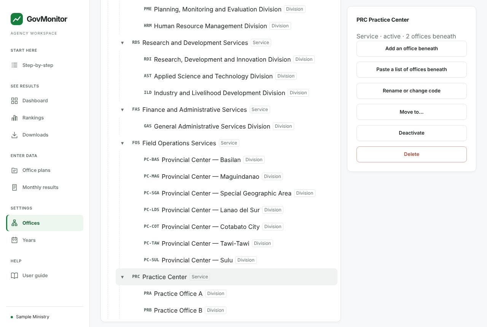

**Check:** Practice Center shows *2 offices beneath*, and Practice Office A and B are listed under it.

<!-- page -->

## Step 2: Set Up the Practice Year

1. Open **Settings → Years** and press **New fiscal year**.
2. **Label:** `Practice 2026`
3. **Starts in the year:** `2026`
4. **Scoring method:** choose **Excel method**.
5. Press **Create**.
6. In the list, press **Open** next to *Practice 2026* and confirm.

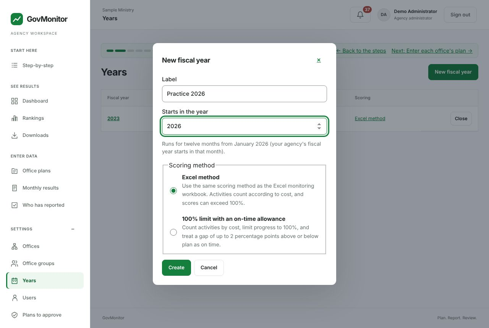

**Check:** *Practice 2026* shows **open** and runs from January 2026 to December 2026. On **Step-by-step**, choose **Year: Practice 2026** at the top.

<!-- page -->

## Step 3: Enter the Two Plans

Go to **Step-by-step**, make sure **Year: Practice 2026** is chosen, and go to step 3. You will see every office of the Sample Ministry; for this exercise, only **PRA** and **PRB** matter. Ignore the others.

**Plan of Practice Office A**

1. Next to **PRA Practice Office A**, press **Start plan**.
2. Set **New row** to **Output** and press **Add at end**. Type **Code** `OUT-01` and **Title** `Community services delivered`. Leave the numbers empty on this heading row.
3. Select the OUT-01 row. Set **New row** to **Activity** and press **Add below selected**. Fill in:
   - **Code** `ACT-01`, **Title** `Community consultation sessions`, **Unit** `session`
   - **Target** `12`, **Unit cost** `5000` — **Total cost** fills itself in as `60000` (12 × 5000) and is greyed out
   - **Measure** Quantity, **Implementing office** PRA
   - **JAN** to **DEC**: `1` in every month (the **Total** column shows 12)
4. Select ACT-01, keep **New row** on **Activity**, press **Add below selected** and fill in:
   - **Code** `ACT-02`, **Title** `Client assistance cases completed`, **Unit** `case`
   - **Target** `120`, **Unit cost** empty (a lump sum), so type **Total cost** `40000` yourself
   - **Measure** Quantity, **Implementing office** PRA
   - **JAN** to **DEC**: `10` in every month (Total 120)
5. Leave **Weight** empty: the app works it out from the costs (ACT-01 60%, ACT-02 40%).
6. Open the **Indicators** tab and press **Add indicator**:
   - **Code** `IND-01`, **Indicator** `Community members reached`, **Kind** Output, **Unit** `person`
   - **Annual target** `600`, **Counted as** *Total of the months*, `50` in every month
7. Press **Save**. The top right shows **Planned cost 100,000.00**.

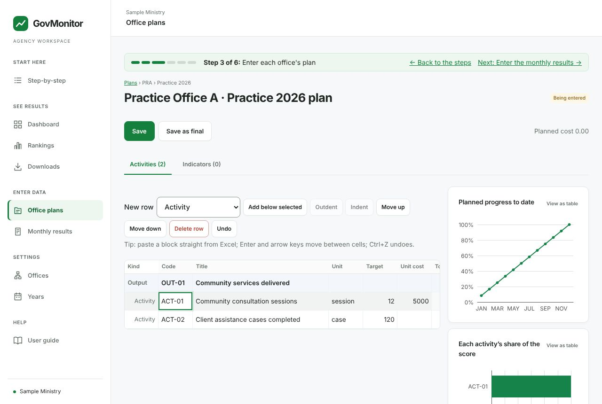

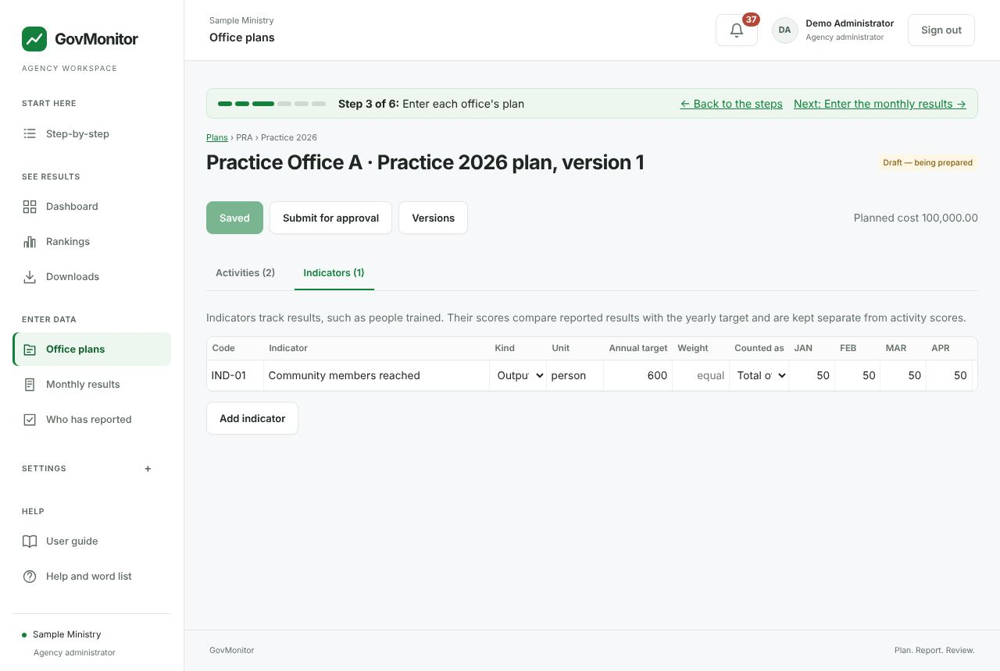

**Plan of Practice Office B**

1. Back on **Step-by-step** (step 3), press **Start plan** next to **PRB Practice Office B**.
2. Set **New row** to **Activity** and press **Add at end**:
   - **Code** `FV-01`, **Title** `Farm visits`, **Unit** `visit`
   - **Target** `24`, **Unit cost** `1250` — **Total cost** fills itself in as `30000` (24 × 1250)
   - **Measure** Quantity, **Implementing office** PRB
   - **JAN** to **DEC**: `2` in every month (Total 24)
3. Press **Save**. Planned cost: **30,000.00**. (No output indicator for this office.)

**Make both plans final**

Back on **Step-by-step** (step 3), press **Mark as final** next to PRA, then next to PRB, and confirm each time.

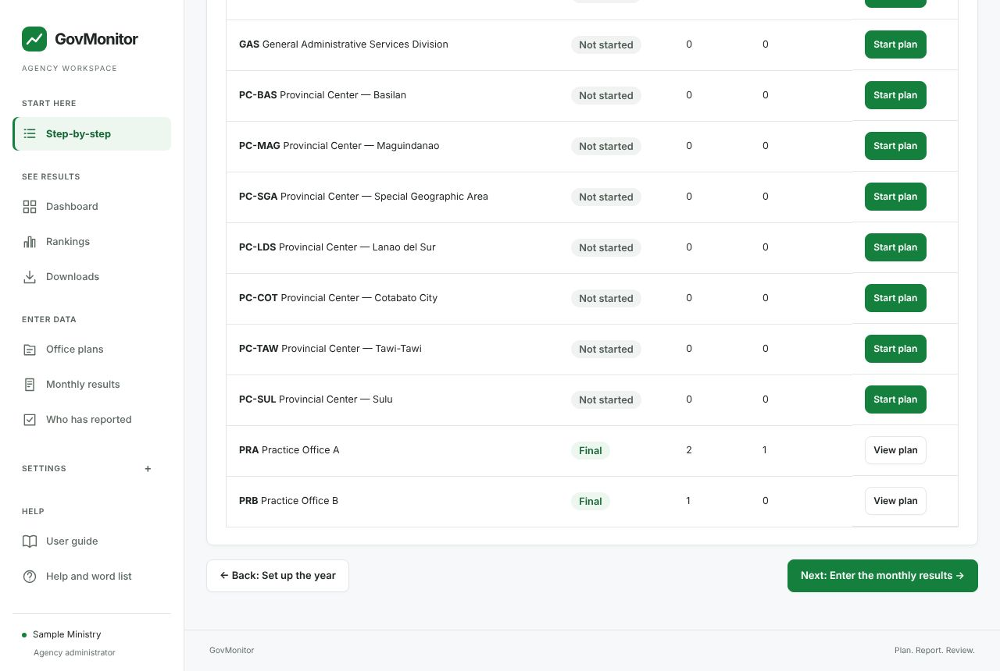

**Check:** PRA shows **Final** with 2 activities and 1 output target; PRB shows **Final** with 1 activity.

<!-- page -->

## Step 4: Enter the January Results

1. On **Step-by-step**, choose **Month: January 2026** at the top and go to step 4. PRA and PRB are listed as *Not started*.
2. Press **Enter results** next to **PRA Practice Office A** and type:
   - ACT-01 **Done this month** `1` — **Remarks** `Sessions held as planned.`
   - ACT-02 **Done this month** `8` — **Reason for delay** `Two clients had incomplete documents. Follow up in February.`
   - **Indicators** tab: IND-01 **Value this month** `45`
3. Press **Save**, then **Submit report** and confirm.
4. Press **Back to the steps**, then **Enter results** next to **PRB Practice Office B**:
   - FV-01 **Done this month** `2`
5. Press **Save**, then **Submit report** and confirm.

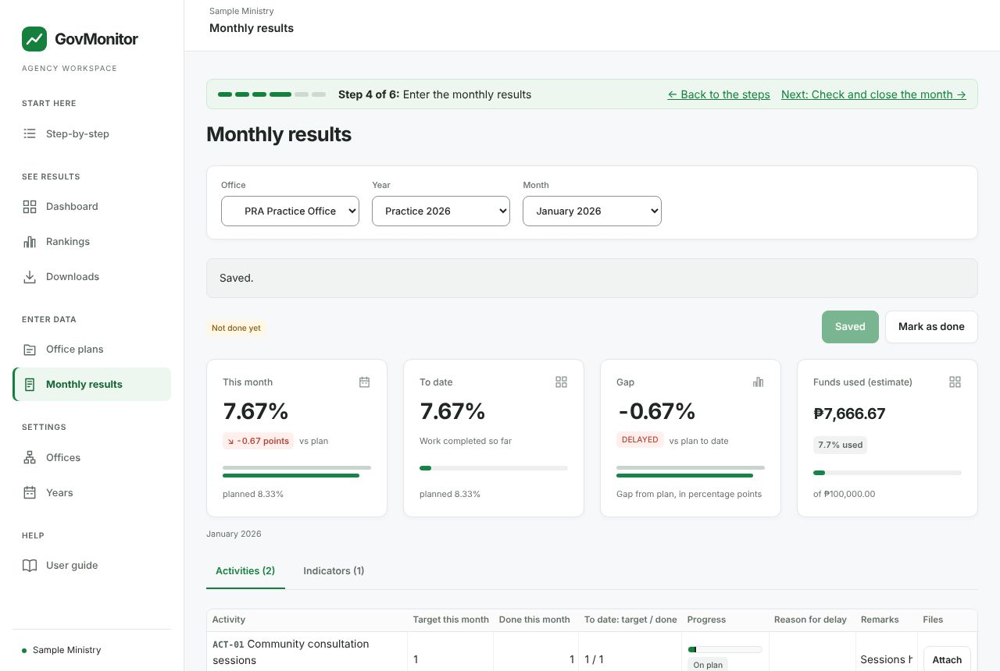

**What you should see on Practice Office A's page (January)**

| Card | Value | What it tells you |
|---|---|---|
| This month | **7.67%** (planned 8.33%) | A little less work than planned this month. |
| To date | **7.67%** | Share of the whole year's work done so far. |
| Gap | **−0.67 points**, **DELAYED** | Slightly behind plan. |
| Funds used (estimate) | **₱7,666.67** of ₱100,000 | 7.7% of the budget. |

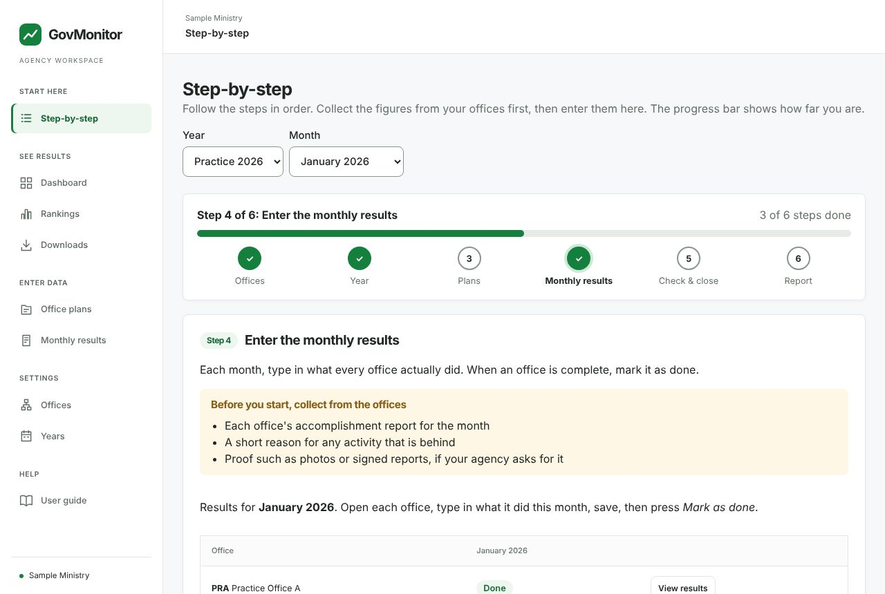

**Check:** step 4 says *2 of 2 offices done for January 2026*.

<!-- page -->

## Step 5: Check and Close January

1. Go to step 5 and press **Open the dashboard**.
2. Choose **Office: PRC Practice Center** at the top. Compare with the table below.

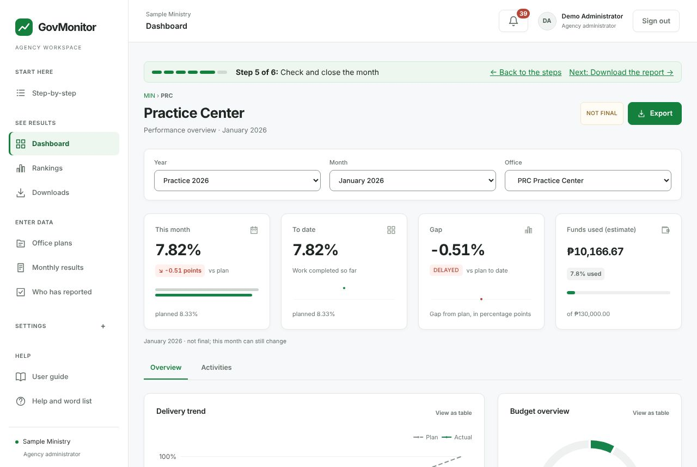

**January results**

| Office | This month | To date | Planned to date | Gap | Status | Funds used |
|---|---|---|---|---|---|---|
| Practice Office A | 7.67% | 7.67% | 8.33% | −0.67 | DELAYED | ₱7,666.67 of ₱100,000 |
| Practice Office B | 8.33% | 8.33% | 8.33% | 0.00 | ON-TIME | ₱2,500.00 of ₱30,000 |
| **Practice Center** | **7.82%** | **7.82%** | **8.33%** | **−0.51** | **DELAYED** | **₱10,166.67 of ₱130,000** |

Output indicator (Practice Office A): **45 of 600 = 7.50%** reached, against **8.33%** planned by January.

3. When the figures match, go back to step 5 and press **Close January 2026**, then confirm.

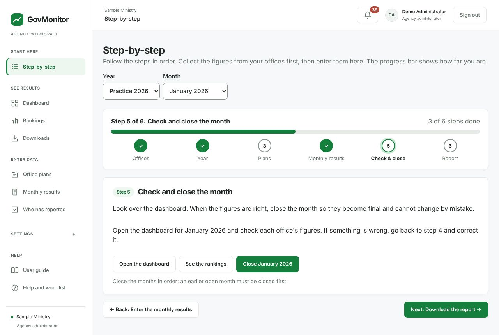

**Check:** step 5 says *January 2026 is closed*, and the dashboard shows **FINAL** for January.

<!-- page -->

## February: Enter, Check and Close

Repeat steps 4 and 5 for February.

1. On **Step-by-step**, choose **Month: February 2026** and go to step 4.
2. **PRA Practice Office A** → **Enter results**:
   - ACT-01 **Done this month** `1`
   - ACT-02 **Done this month** `12` (the 10 planned plus the 2 late January cases; no delay reason is needed now)
   - **Indicators** tab: IND-01 **Value this month** `60`
   - **Save**, then **Submit report**.
3. **PRB Practice Office B** → **Enter results**: FV-01 **Done this month** `3`. **Save**, then **Submit report**.

**Type only what was done in February.** Do not type 2 sessions or 20 cases: those are the totals so far, and the app adds the months for you.

4. Go to step 5, **Open the dashboard**, choose **Office: PRC Practice Center** and **Month: February 2026**.

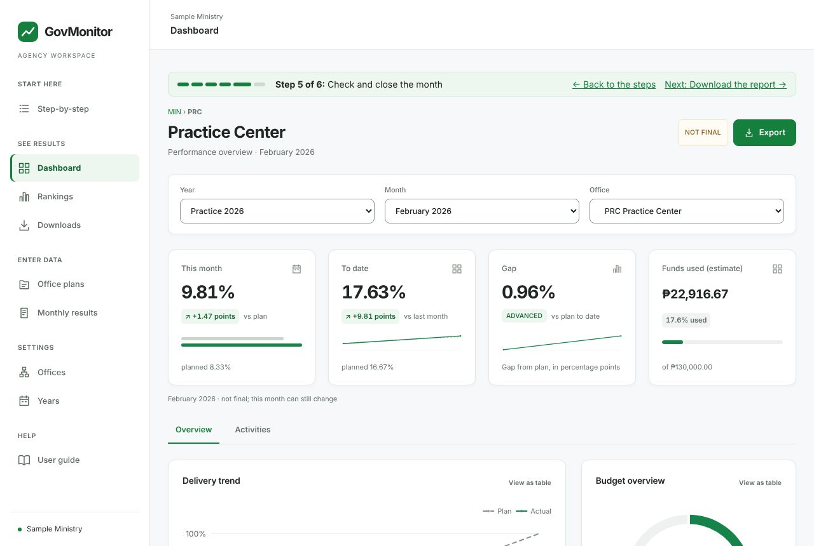

**February results**

| Office | This month | To date | Planned to date | Gap | Status | Funds used | Funds remaining |
|---|---|---|---|---|---|---|---|
| Practice Office A | 9.00% | 16.67% | 16.67% | 0.00 | ON-TIME | ₱16,666.67 | ₱83,333.33 |
| Practice Office B | 12.50% | 20.83% | 16.67% | +4.17 | ADVANCED | ₱6,250.00 | ₱23,750.00 |
| **Practice Center** | **9.81%** | **17.63%** | **16.67%** | **+0.96** | **ADVANCED** | **₱22,916.67** | **₱107,083.33** |

Output indicator (Practice Office A): **105 of 600 = 17.50%** reached, against **16.67%** planned by February — ahead.

5. Press **See the rankings** (or open **Rankings**), choose **Month: February 2026** and **Ranking: Offices under PRC Practice Center**.

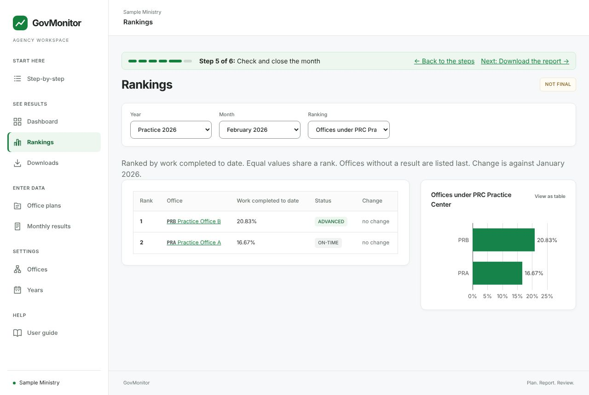

| Rank | Office | Work completed to date | Status |
|---|---|---|---|
| 1 | Practice Office B | 20.83% | ADVANCED |
| 2 | Practice Office A | 16.67% | ON-TIME |

6. Back on step 5, press **Close February 2026** and confirm.

<!-- page -->

## Step 6: Download the Over-All Performance Presentation

For the practice, make the presentation for the **Practice Center** only (the Step-by-step download covers the whole Sample Ministry).

1. Open **Dashboard**, choose **Year: Practice 2026**, **Month: February 2026**, **Office: PRC Practice Center**.
2. Press **Export**.
3. Choose **Over-all performance for the year**.
4. **Title on the first slide:** `Practice Center over-all performance`
5. **What to include:** **PRC Practice Center and every office beneath it**.
6. **Figures as of the end of:** February 2026 (final). Press **Prepare presentation**, then **Download**.

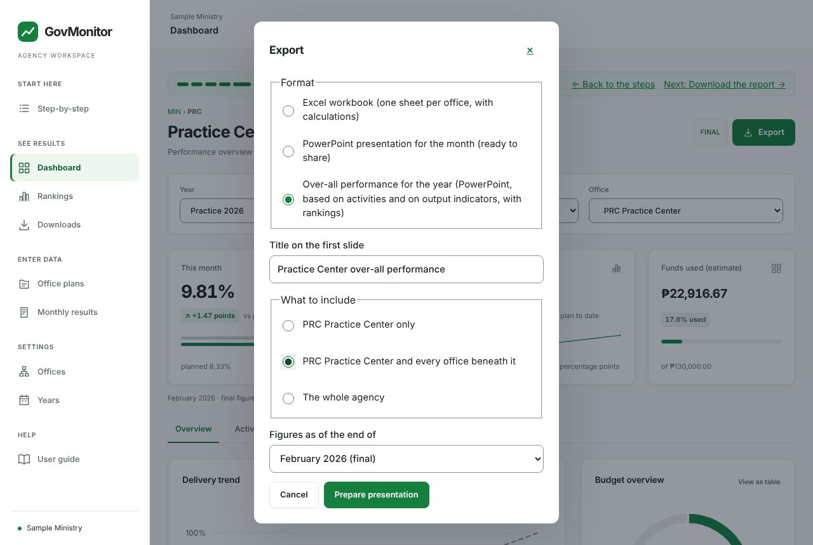

**What the over-all slide shows**

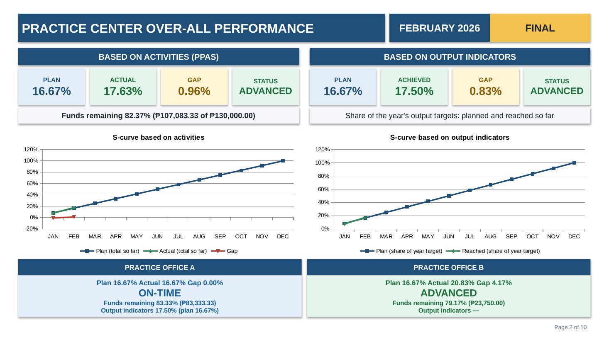

| Panel | Figures |
|---|---|
| Based on activities (PPAs) | Plan 16.67%, Actual 17.63%, Gap 0.96%, **ADVANCED**; funds remaining 82.37% (₱107,083.33 of ₱130,000.00) |
| Based on output indicators | Plan 16.67%, Achieved 17.50%, Gap 0.83%, **ADVANCED** |
| Practice Office A | Plan 16.67%, Actual 16.67%, Gap 0.00%, **ON-TIME**, funds remaining 83.33% |
| Practice Office B | Plan 16.67%, Actual 20.83%, Gap 4.17%, **ADVANCED**, funds remaining 79.17% |

The next slides show each office's dashboard, its activities month by month (dark cell = planned month, yellow cell = month with an accomplishment), the output indicators and the rankings.

<!-- page -->

## How the Numbers Are Worked Out

You never calculate these yourself. This page shows why the app's figures are right.

**1. Each activity's weight comes from its cost.**
Practice Office A's activities cost ₱60,000 and ₱40,000 of ₱100,000, so ACT-01 counts **60%** and ACT-02 **40%** of the office's score.

**2. Progress = share of each activity's yearly target, times its weight.**

| | ACT-01 (60%) | ACT-02 (40%) | Office A |
|---|---|---|---|
| January done | 1 of 12 → 8.33% × 60% = 5.00% | 8 of 120 → 6.67% × 40% = 2.67% | **7.67%** |
| January planned | 1 of 12 → 5.00% | 10 of 120 → 3.33% | **8.33%** |
| To date, February | 2 of 12 → 10.00% | 20 of 120 → 6.67% | **16.67%** |

The office score is **not** the simple average of the two activities.

**3. Gap and status.** Gap = to date − planned to date. January: 7.67% − 8.33% = **−0.67 points** → below zero → **DELAYED**. February: 16.67% − 16.67% = 0 → **ON-TIME**. Above zero → **ADVANCED**.

**4. Funds used (estimate).** Progress × budget: January 7.67% × ₱100,000 = **₱7,666.67**. Remaining: ₱100,000 − ₱7,666.67 = **₱92,333.33**.

**5. Combining offices.** The Practice Center weighs each office by its budget: add up the money-worth of the work done in both offices and divide by their total budget. February: (₱16,666.67 + ₱6,250.00) ÷ ₱130,000 = **17.63%**. Office B's 20.83% counts for less than Office A's 16.67% because B's budget is smaller.

**6. Output indicators.** Reached = total reported ÷ yearly target: February (45 + 60) ÷ 600 = **17.50%**. Planned so far = (50 + 50) ÷ 600 = **16.67%**. Gap +0.83 points → ahead. In December the plan reaches 100%.

**7. Rankings** order the offices by work completed to date: Office B 20.83% is first, Office A 16.67% second.

<!-- page -->

## If Your Numbers Are Different

| Check | Where |
|---|---|
| The year is **Practice 2026** and the month is the one you are checking | Top of every page |
| Total costs are **60000**, **40000** and **30000** (Office A's planned cost 100,000; B's 30,000) | The plan page, top right |
| Jan–Dec add up to the Target: **12**, **120**, **24**; indicator **600** | The **Total** column of each plan |
| You typed the month's figure, not the running total (February ACT-02 is **12**, not 20) | Monthly results |
| Both plans are **Final** and both offices are **Done** for the month | Step-by-step, steps 3 and 4 |
| The scoring method is **Excel method** | Settings → Years → *Practice 2026* |

To fix a figure in a closed month: **Who has reported** → choose the month → **Reopen** (type a reason), correct it, then close the month again. Reopen the latest month first.

<!-- page -->

## When You Are Done Practising

- You can keep the practice data: it stays in the Sample Ministry and **Practice 2026** and does not mix with a real year.
- Or remove it: **Settings → Offices**, select **Practice Center**, press **Delete**, tick *I understand this cannot be undone* and press **Delete permanently**. The Practice Center, both offices, their plans and all their results are deleted. The same works for the Sample Ministry's other offices if you want to start from an empty list.
- To start your real work, type `./run.sh setup` in Git Bash. It creates your real agency and administrator and switches the practice agencies off. Nothing is deleted.
- Then follow the general **User Guide**: the same six steps, with your own offices and figures.
